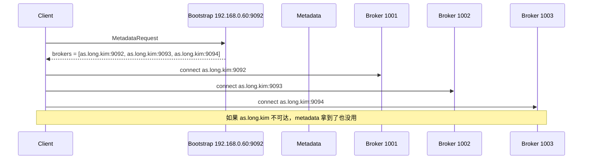

> **归档说明（2026-11-10）**：本文是业务侧 2026-11-09 提交的原始说明。平台已按本文方案 A 修正：三个 broker 的 `advertised.listeners` 已改为 `192.168.0.60:9092/9093/9094`，标准 Kafka 客户端 metadata 与三分区写入均已验证通过。当前有效文档见 [`KAFKA_EXTERNAL_ACCESS.md`](KAFKA_EXTERNAL_ACCESS.md)。

# 为什么 Kafka advertised.listeners 必须改为 192.168.0.60

> **状态提示（2026-11-26）**：本文为阶段材料；当前 Kafka 已切 SASL_PLAINTEXT/GSSAPI，
> 架构与客户端配置以 [`ARCHITECTURE.md`](ARCHITECTURE.md) / [`KAFKA_EXTERNAL_ACCESS.md`](KAFKA_EXTERNAL_ACCESS.md) 为准。


> 日期：2026-11-09  
> 对象：HodoopForge 平台 / Kafka 运维  
> 结论：**9093/9094 端口开放 ≠ Kafka 客户端可用**。当前 broker 仍 advertise `as.long.kim:9092/9093/9094`，从应用宿主不可达；应用侧只是用了一个 Python 进程内的解析覆盖在兜底。  
> 复验脚本：`scripts/verify_kafka_external.py --produce`

---

## 1. 平台为什么觉得“已经 OK”

平台做了两件正确的事：

1. 在 `192.168.0.60` 上开放了 9092/9093/9094；
2. 验证了三个端口 TCP 可达，且应用侧三分区写入成功。

但这两件事只证明了 **bootstrap 端口**和 **应用侧被覆盖后的路径**可用，没有证明 **Kafka 返回给客户端的 advertised 地址**可用。

`verify_kafka_external.py --produce` 的实测输出：

```json
{
  "advertised": [
    {"node_id": 1001, "host": "as.long.kim", "port": 9092, "tcp_ok": false},
    {"node_id": 1002, "host": "as.long.kim", "port": 9093, "tcp_ok": false},
    {"node_id": 1003, "host": "as.long.kim", "port": 9094, "tcp_ok": false}
  ],
  "advertised_all_reachable": false,
  "scoped_write": {
    "probe": "probe-2796f3408e",
    "partitions": {"0": {"ok": true, "offset": 59},
                   "1": {"ok": true, "offset": 33},
                   "2": {"ok": true, "offset": 39}},
    "ok": true
  },
  "status": "override_required"
}
```

也就是说：

- **端口开放**：`192.168.0.60:9093/9094` 是通的；
- **advertised 地址**：Kafka 仍然告诉客户端“去 `as.long.kim:9093` 找我”；
- `as.long.kim` 解析到 `202.105.190.2`，该地址的 9092/9093/9094 从应用宿主 **EHOSTUNREACH / closed**；
- 应用侧之所以能写，是因为 Python 进程里把 `as.long.kim` 在 Kafka 端口上改写成了 `192.168.0.60`。

**平台看到“三分区写成功”，是因为应用侧做了覆盖；一个标准 Kafka 客户端（Java/Python/Go/CLI/监控）没有这个覆盖，仍然会失败。**

---

## 2. Kafka 客户端到底怎么连

Kafka 不是“只连 bootstrap 就完事”。标准流程是：



关键点：

1. **bootstrap 只负责“问路”**；
2. 真正的生产/消费要连 **metadata 返回的每个 broker**；
3. 如果 advertised 地址不可达，客户端会：
   - `KafkaAdminClient` → `NodeNotReadyError`；
   - `KafkaProducer` → `KafkaTimeoutError: Batch ... expired`；
   - Java 客户端 → `TimeoutException: Failed to update metadata`；
   - CLI → `Connection to node ... could not be established`。

这不是“应用侧代码问题”，是 **Kafka 服务端告诉客户端一个错误地址**。

---

## 3. 当前应用侧覆盖是什么，为什么不能长期用

代码：`src/open_llm_vtuber/analytics/kafka_events.py::_install_advertised_host_override`

```env
EDULAKE_KAFKA_ADVERTISED_HOST_OVERRIDE=as.long.kim=192.168.0.60
EDULAKE_KAFKA_ADVERTISED_PORTS=9092,9093,9094
```

它只做一件事：在本 Python 进程内，把 `as.long.kim` 在 Kafka 端口上的 DNS 解析改成 `192.168.0.60`。这样做是为了不破坏 `as.long.kim:3689` 的 HTTP 代理。

**它的局限**：

| 局限 | 后果 |
|---|---|
| 只对 Python 进程生效 | Java/Flink/Spark/Kafka CLI/监控/新容器不生效 |
| 进程内 monkeypatch | 换语言、换 SDK、换容器就失效 |
| 依赖 `.env` | 部署漏配就故障 |
| 掩盖平台问题 | 监控看到“能写”，但标准客户端不可用 |
| 不支持新 broker | 新增 broker 仍 advertise 公网域名 |
| 安全边界模糊 | 生产不应依赖 DNS 改写 |

**结论**：它是事故期的临时兜底，不是生产架构。一个专业的数据平台不应该让每个客户端各自打补丁。

---

## 4. 两种正确修法

### 方案 A（推荐）：advertised.listeners 改成内网可达地址

在每个 broker 的 `server.properties`（或 Ambari Kafka 配置）中设置：

```properties
# broker 1001
listeners=PLAINTEXT://0.0.0.0:9092
advertised.listeners=PLAINTEXT://192.168.0.60:9092

# broker 1002
listeners=PLAINTEXT://0.0.0.0:9093
advertised.listeners=PLAINTEXT://192.168.0.60:9093

# broker 1003
listeners=PLAINTEXT://0.0.0.0:9094
advertised.listeners=PLAINTEXT://192.168.0.60:9094
```

注意：

- 三个 broker 的 `listeners` 端口可以不同，但 **advertised 必须是客户端能到的地址**；
- 如果 broker 在容器内，`192.168.0.60` 是 NAT 网关地址，需要确认 9093/9094 的 DNAT 指向 1002/1003；
- 改完滚动重启 Kafka，并确认 controller 选举正常。

### 方案 B：放通公网地址到应用出口

如果坚持 advertise `as.long.kim`：

- 在 `202.105.190.2` 上放通 9092/9093/9094；
- 允许应用出口 `192.168.0.168`（网关 `192.168.0.1`）访问；
- 确认 NAT 回流（hairpin）正常；
- 评估公网暴露 Kafka 的安全风险（建议至少 ACL/TLS）。

**推荐 A**：内网地址更安全、更稳定，不依赖公网 NAT。

---

## 5. 验收标准（平台改完后怎么证明真的 OK）

不要只看“端口通”或“应用能写”。按下面四条验收：

1. **裸客户端 metadata**
   ```bash
   .venv/bin/python scripts/verify_kafka_external.py --produce
   ```
   期望：`status = platform_ok`，`advertised_all_reachable = true`。

2. **不依赖任何 hosts/override 的标准客户端**
   ```python
   from kafka import KafkaProducer
   p = KafkaProducer(bootstrap_servers=[
       "192.168.0.60:9092", "192.168.0.60:9093", "192.168.0.60:9094"
   ])
   for part in (0, 1, 2):
       p.send("ai_inference_log", {"probe": "clean"}, partition=part).get(10)
   ```
   期望：三个 partition 都成功；不设置 `EDULAKE_KAFKA_ADVERTISED_HOST_OVERRIDE`。

3. **管理面**
   ```python
   KafkaAdminClient(bootstrap_servers=[...]).describe_cluster()
   ```
   期望：返回 3 个 broker，host/port 为 `192.168.0.60:9092/9093/9094`，无 `NodeNotReadyError`。

4. **业务面**
   - `/ops/kafka-health`：`rf_ok=true`、`non_ha_topics=[]`、`warning=''`；
   - Flink 3 sink 继续 RUNNING，checkpoint 0 失败；
   - 真实教学会话的 RAG/LLM 事件继续入 `-ha` ODS。

验收通过后，应用侧删除：

```env
EDULAKE_KAFKA_ADVERTISED_HOST_OVERRIDE=
```

并保留 `EDULAKE_KAFKA_BROKERS=192.168.0.60:9092,192.168.0.60:9093,192.168.0.60:9094`。

---

## 6. 给平台的一句话

> 你们开放的 9093/9094 端口是对的，但 Kafka 仍把 `as.long.kim:9092/9093/9094` 返回给客户端；`as.long.kim` 解析到 `202.105.190.2`，从应用宿主不可达。应用侧现在能写，是因为 Python 进程内把 `as.long.kim` 改写成了 `192.168.0.60`。请把三个 broker 的 `advertised.listeners` 改成 `192.168.0.60:9092/9093/9094`（或放通公网地址到 `192.168.0.168`），然后跑 `scripts/verify_kafka_external.py --produce`，看到 `platform_ok` 才算真正完成。

---

## 7. 附：为什么“应用能写”会误导

应用侧同时做了三件事，导致平台侧看起来一切正常：

1. `EDULAKE_KAFKA_BROKERS` 指向 `192.168.0.60:9092/9093/9094`（bootstrap 通）；
2. `EDULAKE_KAFKA_ADVERTISED_HOST_OVERRIDE` 把 advertised 域名改写为 `192.168.0.60`；
3. 生产/管理客户端都在这个 Python 进程内，自动继承覆盖。

所以“应用能写”只证明 **应用侧兜底有效**，不证明 **Kafka 服务端配置正确**。这正是需要在平台侧修掉的原因。
