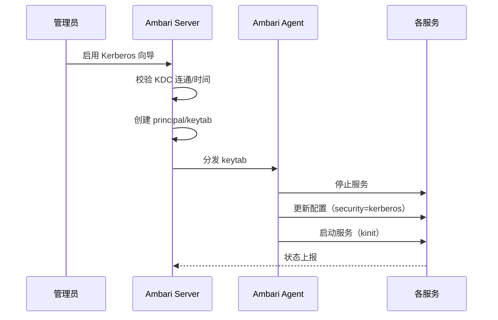

# Kerberos 启用工作方案

> **状态提示（2026-11-26）**：本文为历史/阶段材料；当前集群架构、Kerberos、HA 与端口以
> [`ARCHITECTURE.md`](ARCHITECTURE.md) 和 [`CURRENT_STATE.md`](CURRENT_STATE.md) 为准。


> **文档编号**：HODOOPFORGE-KRB-001  
> **版本**：v1.0  
> **日期**：2026-11-04  
> **适用**：qixuandata 集群（Ambari 3.1.0 / BIGTOP 3.5.0，当前非 Kerberos）  
> **目标**：启用 Kerberos 强认证，满足生产安全合规（ACC-02）

---

## 〇、2026-11-20 前置进展

| 项 | 状态 |
|---|---|
| 时间同步 | ✅ 4 节点已运行真实 chronyd（`hodoopforge-chronyd.service`），偏移均 <1ms |
| KDC 软件包 | ✅ h0/h3 已装 `krb5-server`/`krb5-workstation`；h1/h2 已装 `krb5-workstation` |
| 本地 yum 源 | ⚠️ `ambari`/`BIGTOP` 仓库 repodata 缺失；安装时用 `--disablerepo='*' --enablerepo=baseos --enablerepo=appstream` |
| KDC realm / keytab | ⏳ 未创建（留给 Ambari Kerberos 向导或维护窗口） |
| 业务客户端改造 | ⏳ 未开始 |

> 现在只差“维护窗口 + realm/keytab + 客户端改造”，不再受时间同步和软件包阻塞。

## 一、现状与差距

### 1.1 当前状态（实测 2026-11-04）

| 项 | 状态 |
|---|---|
| Ambari KERBEROS 服务 | ❌ 未启用 |
| keytab | ❌ 无 |
| KDC（88 端口） | ❌ 不可达（60/168 均无） |
| krb5 客户端库 | ✅ 已装（krb5-libs 1.18.2） |
| `/etc/krb5.conf` | ⚠️ 存在但为默认（未指向 KDC） |
| Ambari Kerberos 支持 | ✅ 有（kerberos-client jar） |
| Ranger | ✅ 已启用（仅授权） |
| **时间同步** | ⚠️ **h0/h1 chronyd inactive，h2/h3 active（不一致）** |

### 1.2 差距


| 缺口 | 影响 |
|---|---|
| 无 KDC | 无法签发票据 |
| 时间不同步 | Kerberos 要求时钟偏差 <5min，否则认证失败 |
| 无 keytab | 服务无法以 principal 身份启动 |
| 客户端未改造 | 业务 JDBC/Kafka 连接需认证 |

---

## 二、前置条件（必须先完成）

| # | 条件 | 当前 | 动作 |
|---|---|---|---|
| 1 | KDC 可用 | ❌ | 部署 MIT KDC 或对接企业 AD |
| 2 | 时间同步 | ⚠️ | **所有节点启用 chronyd 并指向同一源** |
| 3 | DNS/主机名 | ✅ | FQDN 已就绪 |
| 4 | krb5.conf | ⚠️ | 指向 KDC realm |
| 5 | 维护窗口 | — | 全服务重启（预计 1-2 小时） |
| 6 | 业务方配合 | — | 客户端认证改造 |

### 2.1 时间同步（先做）

```bash
# 所有节点（h0-h3）
systemctl enable --now chronyd
chronyc sources -v      # 确认同步源
chronyc tracking        # 确认偏移 < 1s

# 若容器内无可用 NTP 源，可指向宿主机
# /etc/chrony.conf: server 192.168.0.60 iburst
```

> **关键**：Kerberos 默认允许 5 分钟偏差，超时会导致 `Clock skew too great`。

---

## 三、方案选型

| 方案 | 适用 | 优点 | 缺点 |
|---|---|---|---|
| **A. MIT KDC（自建）** | 独立集群 | 完全可控、免费 | 需自维护 |
| **B. 对接企业 AD** | 有域环境 | 统一账号 | 需 AD 管理员配合、跨域信任 |

> 建议：**测试环境用 A（MIT KDC）**，生产若有 AD 用 B。

---

## 四、实施步骤（方案 A：MIT KDC）

### 阶段 0：准备（0.5 天）


#### 0.1 部署 KDC（建议独立节点/容器，勿与 h0 混部）

```bash
# Rocky Linux 8
dnf install -y krb5-server krb5-workstation

# /var/kerberos/krb5kdc/kdc.conf
[realms]
  QIXUANDATA.LOCAL = {
    kadmind_port = 749
    max_life = 12h
    max_renewable_life = 7d
    supported_enctypes = aes256-cts:normal aes128-cts:normal
  }

# /etc/krb5.conf
[libdefaults]
  default_realm = QIXUANDATA.LOCAL
  dns_lookup_realm = false
  dns_lookup_kdc = false
  ticket_lifetime = 24h
  renew_lifetime = 7d
  forwardable = true

[realms]
  QIXUANDATA.LOCAL = {
    kdc = kdc.qixuandata.local:88
    admin_server = kdc.qixuandata.local:749
  }

[domain_realm]
  .bigtop.apache.org = QIXUANDATA.LOCAL
  bigtop.apache.org = QIXUANDATA.LOCAL
```

```bash
# 初始化数据库
kdb5_util create -s -r QIXUANDATA.LOCAL
# 启动
systemctl enable --now krb5kdc kadmin
# 创建管理员
kadmin.local -q "addprinc admin/admin"
```

#### 0.2 分发 krb5.conf 到所有节点

```bash
for h in bigtop_hostname0 bigtop_hostname1 bigtop_hostname2 bigtop_hostname3; do
  docker cp /etc/krb5.conf $h:/etc/krb5.conf
done
```

#### 0.3 验证

```bash
kinit admin
klist
```

### 阶段 1：创建服务 principal 与 keytab（0.5 天）

```bash
# 为每个服务创建 principal（示例）
for svc in hdfs yarn mapred hbase hive kafka zookeeper ranger ambari-qa spark flink; do
  kadmin.local -q "addprinc -randkey ${svc}/bigtop-hostname0.bigtop.apache.org@QIXUANDATA.LOCAL"
  kadmin.local -q "ktadd -k /etc/security/keytabs/${svc}.service.keytab ${svc}/bigtop-hostname0.bigtop.apache.org@QIXUANDATA.LOCAL"
done
```

**注意**：Ambari 的 Kerberos 向导会自动创建大部分 principal/keytab，手工方式仅用于预演或 AD 场景。

### 阶段 2：Ambari 启用 Kerberos（1-2 小时，含重启）



**Ambari 向导关键项**：

| 项 | 值 |
|---|---|
| KDC 类型 | MIT KDC / Existing AD |
| Realm | QIXUANDATA.LOCAL |
| KDC Host | kdc.qixuandata.local |
| KDC Port | 88 |
| Admin Server | kdc.qixuandata.local:749 |
| Admin Principal | admin/admin |
| 域 | bigtop.apache.org |
| 启用后 | 所有服务重启 |

**会被改造的服务**：
- HDFS（NN/DN/SNN）
- YARN（RM/NM）
- HBase（Master/RS）
- Hive（HS2/Metastore）
- Kafka（Broker）
- ZooKeeper（SASL）
- Ranger
- Spark（ThriftServer）
- Flink（JM/TM）

### 阶段 3：服务验证（0.5 天）

```bash
# HDFS
kinit -kt /etc/security/keytabs/hdfs.headless.keytab hdfs-bigtop-hostname0
hdfs dfs -ls /

# Hive
beeline -u "jdbc:hive2://bigtop-hostname0:10000/default;principal=hive/bigtop-hostname0@QIXUANDATA.LOCAL"

# HBase
kinit -kt /etc/security/keytabs/hbase.headless.keytab hbase-bigtop-hostname0
hbase shell

# Kafka（SASL_PLAINTEXT）
kafka-topics.sh --bootstrap-server ... --command-config client.properties
```

### 阶段 4：Flink 与业务接入（1 天）

#### 4.1 Flink 配置

```yaml
# flink-conf.yaml
security.kerberos.login.use-ticket-cache: false
security.kerberos.login.keytab: /etc/security/keytabs/flink.keytab
security.kerberos.login.principal: flink@QIXUANDATA.LOCAL
security.kerberos.login.contexts: Client,KafkaClient
```

> 作业提交时需 `kinit` 或配置 keytab；Kafka/Iceberg/HDFS 访问需相应 context。

#### 4.2 业务客户端（168）

```bash
# 安装 krb5-workstation，分发 krb5.conf
# 申请 keytab 或使用 kinit
kinit -kt /path/app.keytab app/bigtop-hostname0@QIXUANDATA.LOCAL
# JDBC 连接串加 principal
jdbc:hive2://bigtop-hostname0:10000/default;principal=hive/bigtop-hostname0@QIXUANDATA.LOCAL
```

### 阶段 5：验收（0.5 天）

| 检查 | 期望 |
|---|---|
| `kinit` 成功 | ✅ |
| 各服务启动 | ✅ |
| HDFS/Hive/HBase/Kafka 读写 | ✅ |
| Flink 作业 RUNNING | ✅ |
| 业务 JDBC 认证 | ✅ |
| Ranger 策略生效 | ✅ |
| Ambari 告警 | 无非 OK |
| ACC-02 | PASS |

---

## 五、关键风险与回滚

### 5.1 风险

| 风险 | 影响 | 缓解 |
|---|---|---|
| **时间不同步** | 认证失败 `Clock skew` | 先修 chronyd |
| keytab 遗漏 | 服务启动失败 | 用 Ambari 向导自动生成 |
| 客户端未改造 | 业务中断 | 提前通知 + 提供 krb5.conf/keytab |
| 全服务重启 | 停机 1-2h | 维护窗口 |
| Flink 作业 | 需重提交 | 保留 SQL/checkpoint |
| Ranger 策略 | 认证后权限变化 | 提前配策略 |
| Docker 容器 | KDC 网络 | KDC 独立部署，网络互通 |

### 5.2 回滚

```bash
# Ambari 提供 "Disable Kerberos" 向导
# 或手工：
# 1) 停止服务
# 2) cluster-env.security_enabled=false
# 3) 恢复非安全配置
# 4) 启动服务
# 5) 业务恢复无认证连接
```

> **建议**：先在**测试集群**完整演练一次，记录回滚步骤与耗时。

---

## 六、工作量与排期

| 阶段 | 内容 | 工作量 | 责任 |
|---|---|---|---|
| 0 | 时间同步 + KDC 部署 + krb5.conf | 0.5 天 | 平台 |
| 1 | principal/keytab（或向导自动） | 0.5 天 | 平台 |
| 2 | Ambari 启用 + 全服务重启 | 0.5 天（含窗口） | 平台 |
| 3 | 服务验证 | 0.5 天 | 平台 |
| 4 | Flink + 业务客户端改造 | 1 天 | 平台 + 业务 |
| 5 | 验收 | 0.5 天 | 双方 |
| **合计** | | **约 3.5 天**（不含测试集群演练） | |

**建议排期**：测试集群 2 天演练 → 生产窗口 4 小时（阶段 2）+ 验证。

---

## 七、测试集群演练清单

| # | 步骤 | 通过标准 |
|---|---|---|
| 1 | 部署 KDC | `kinit` 成功 |
| 2 | 时间同步 | `chronyc tracking` 偏移 <1s |
| 3 | Ambari 启用 | 所有服务 STARTED |
| 4 | HDFS/Hive/HBase/Kafka | 读写正常 |
| 5 | Flink 作业 | RUNNING + checkpoint |
| 6 | 业务 JDBC | 认证成功 |
| 7 | 回滚 | 恢复非 Kerberos |
| 8 | 再启用 | 可重复 |

---

## 八、对业务方的影响（需提前沟通）

| 项 | 影响 | 业务方动作 |
|---|---|---|
| JDBC 连接 | 需 principal/keytab | 改造连接串 |
| Kafka 客户端 | SASL 认证 | 配置 JAAS |
| 定时任务 | 需 kinit 续期 | 配置 keytab |
| BI 工具 | 需 Kerberos 支持 | 升级/配置 |
| 开发调试 | 需 kinit | 培训 |

---

## 九、结论与建议

1. **Kerberos 可启用**，但**前置条件必须先满足**：KDC + 时间同步。
2. **当前最大隐患是时间同步不一致**（h0/h1 chronyd inactive），务必先修。
3. **建议测试集群先行演练**，再排生产窗口；准备回滚方案。
4. **业务客户端改造是最大变量**，需提前沟通与培训。
5. 工作量约 **3.5 天**（不含演练），停机窗口约 **1-2 小时**。

> 平台可在 KDC 就绪后提供：Ambari 向导操作、keytab 分发、Flink/业务配置模板、回滚脚本。
