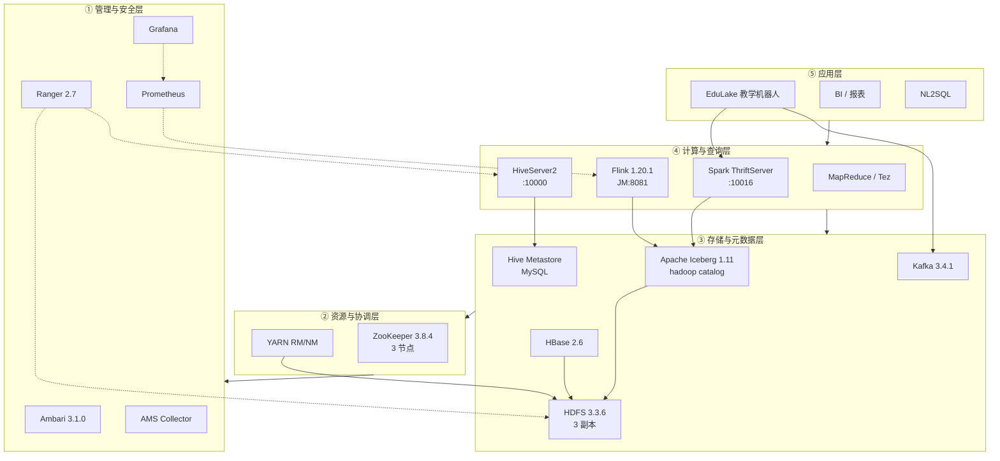
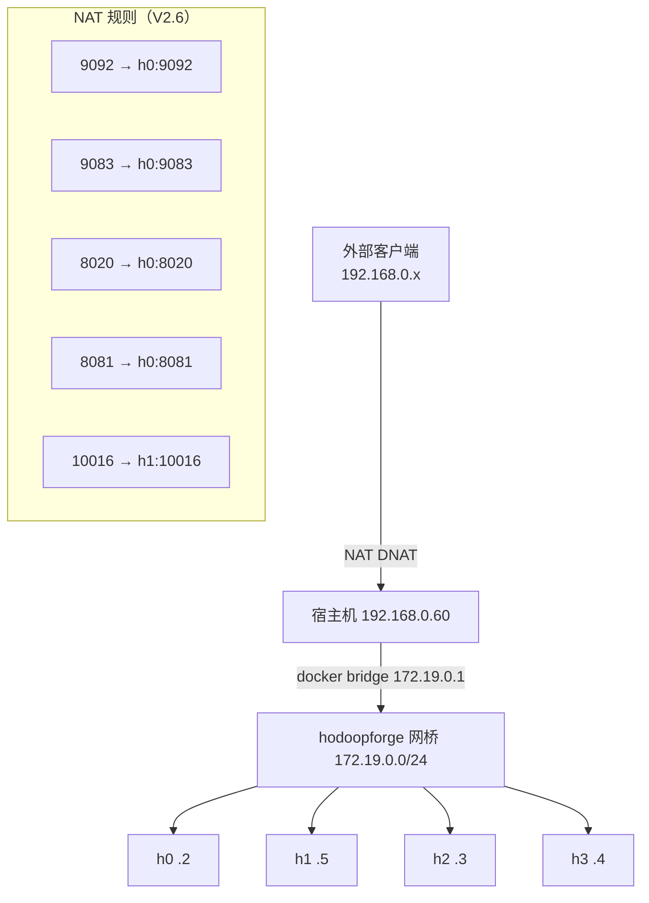
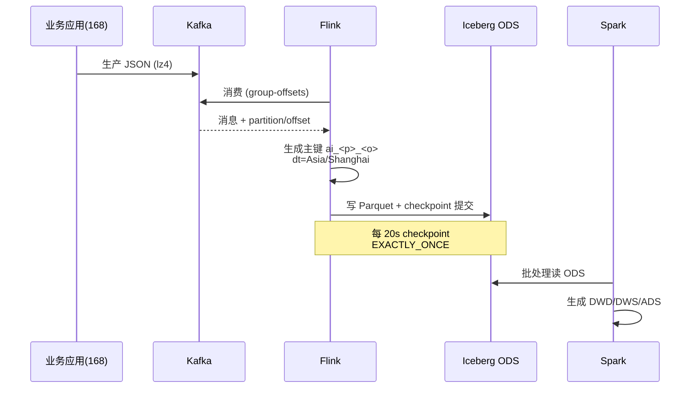
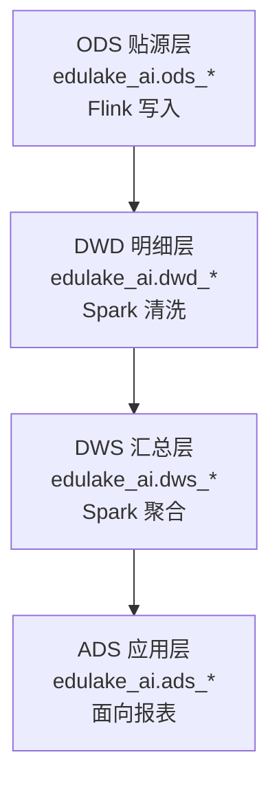
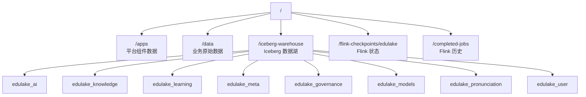

# 01 · 架构设计

> **状态提示（2026-11-26）**：本文为 v3.0 阶段手册；当前 Kerberos 架构、HA 与端口以
> [`../ARCHITECTURE.md`](../ARCHITECTURE.md) 和 [`../CURRENT_STATE.md`](../CURRENT_STATE.md) 为准。


> 版本：v3.0 · 2026-11-09  
> 读者：架构师、运维、技术评审  
> **v3.0 更新**：HDFS 2 NN + 3 JN + 2 ZKFC；Kafka 3 broker；Flink 20s Exactly-Once；Iceberg 70 表；详见 [10 · HA 与业务联通验收](10-ha-and-business-connectivity.md)。

---

## 1. 架构总览

### 1.1 分层架构



### 1.2 设计原则

| 原则 | 落地 |
|---|---|
| **控制面与数据面分离** | h0 承载管理/元数据；h1-h3 承载数据/计算 |
| **容器级 HA** | 故障域是容器：2 NN + 3 JN + 2 ZKFC、Kafka 3 broker、Flink 20s checkpoint |
| **单写者** | ODS 仅 Flink 写；DWD/DWS/ADS 仅 Spark 写 |
| **共享存储** | 实时与离线共享同一 Iceberg warehouse（`-ha` 独立目录） |
| **开放格式** | Iceberg + Parquet，避免厂商锁定 |
| **可回滚** | 旧 `/iceberg-warehouse` 保持不动，旧 authority 仅用于回滚读取 |

---

## 2. 部署架构

### 2.1 节点拓扑（2026-11-09 HA 版）

```mermaid
flowchart LR
    subgraph HOST["宿主机 192.168.0.60 / 48GB"]
        subgraph H0["h0 172.19.0.2 (控制面)"]
            NN1["NameNode nn1<br/>ACTIVE"]
            ZKFC1["ZKFC"]
            JN1["JournalNode"]
            RM["ResourceManager"]
            HM["HBase Master"]
            HS2_["HiveServer2/Metastore"]
            RA["Ranger Admin/Usersync/KMS"]
            KB1["Kafka Broker 1001"]
            FJM["Flink JobManager"]
            SOLR["Infra Solr"]
            ZK0["ZooKeeper"]
            MYSQL["MySQL"]
            AMB["Ambari Server"]
            AMSC["AMS Collector"]
            GR["Grafana"]
        end
        subgraph H1["h1 172.19.0.5"]
            DN1["DataNode"]
            NM1["NodeManager"]
            JN2["JournalNode"]
            ATS["AppTimelineServer"]
            ST["Spark ThriftServer"]
            ZK1["ZooKeeper"]
        end
        subgraph H2["h2 172.19.0.3"]
            DN2["DataNode"]
            NM2["NodeManager"]
            KB2["Kafka Broker 1002"]
            FTM2["Flink TaskManager"]
            ZK2["ZooKeeper"]
        end
        subgraph H3["h3 172.19.0.4"]
            NN2["NameNode nn2<br/>STANDBY"]
            ZKFC2["ZKFC"]
            JN3["JournalNode"]
            DN3["DataNode"]
            NM3["NodeManager"]
            RS["HBase RegionServer"]
            KB3["Kafka Broker 1003"]
            FTM3["Flink TaskManager"]
            ZK3["ZooKeeper"]
        end
    end

    NN1 <-->|shared edits| JN1
    NN1 <-->|shared edits| JN2
    NN1 <-->|shared edits| JN3
    NN2 <-->|shared edits| JN1
    NN2 <-->|shared edits| JN2
    NN2 <-->|shared edits| JN3
    ZKFC1 -.->|ZK 选举| ZK1
    ZKFC2 -.->|ZK 选举| ZK1
    KB1 <-->|RF3| KB2
    KB1 <-->|RF3| KB3
    KB2 <-->|RF3| KB3
```



> **v3.0 变更**：删除 SecondaryNameNode；h3 新增 Standby NameNode、ZKFC、JournalNode；Kafka 扩为 3 broker（h0/h2/h3）；Flink checkpoint 固定 20s。

### 2.2 资源分配（实测）

| 节点 | 内存上限 | JVM 堆（关键） | 角色定位 |
|---|---|---|---|
| h0 | 20g | NN1 1536m / RM 1536m / HMaster 1024m / HS2 1024m / Ranger 768m/512m / Solr 1024m / Ambari 1024m | 控制面 + HA |
| h1 | 10g | DN 512m / NM 1024m / JN / ATS 512m / Spark Thrift 1024m | 计算+查询 |
| h2 | 9g | DN 512m / NM 1024m / Kafka broker / Flink TM 2048m×2slots | 计算+消息 |
| h3 | 10g | DN 512m / NM 1024m / NN2 1536m / ZKFC / JN / HBase RS 2048m / Kafka broker / Flink TM | 数据+计算+HA |

> 宿主机 **48GB**（2026-11-08 +8GB），容器共享内存视图；**复核** used ≈ 39GB、avail ≈ 8GB、Swap 使用约 5.5GB（`si/so` 接近 0）。容器上限 h0 20 / h1 10 / h2 9 / h3 10 GB（2026-11-24 h3 9→10，避免 OOM）。

### 2.3 网络架构



**关键网络规则**：
- DNAT 加 `-m addrtype --dst-type LOCAL` 守卫，避免劫持容器间通信
- MASQUERADE 仅限 `-s 172.19.0.0/24 ! -d 172.19.0.0/24`
- 容器内访问 Kafka 必须用 **FQDN**（`bigtop-hostname0.bigtop.apache.org:9092`），`localhost` 因 advertised listener 超时

---

## 3. 数据流架构

### 3.1 实时链路（生产）



### 3.2 离线链路


### 3.3 数据分层



---

## 4. 存储架构

### 4.1 HDFS 目录规划



### 4.2 Iceberg 目录结构（单表）

```
/iceberg-warehouse/edulake_ai/ods_llm_inference_log/
├── data/
│   └── dt=2026-11-03/
│       └── 00000-0-<uuid>.parquet     # 数据文件（zstd）
└── metadata/
    ├── v1.metadata.json               # 表元数据（schema/分区/快照）
    ├── v2.metadata.json
    ├── snap-<id>-1-<uuid>.avro        # 快照 manifest list
    └── <uuid>-m0.avro                 # manifest（数据文件列表）
```

### 4.3 存储容量（实测）

| 指标 | 值 |
|---|---|
| HDFS 配置容量 | 1.21 TB |
| 已用 | 22.67 GB（2.84%） |
| 剩余 | 775.44 GB |
| 副本 | 3 |
| 缺失/副本不足块 | 0 / 0 |
| 单表（ODS llm） | 15 文件 / 64 KB / 16 行 |

---

## 5. 技术栈矩阵

| 层 | 组件 | 版本 | 端口 | 备注 |
|---|---|---|---|---|
| 管理 | Ambari | 3.1.0 | 20609→8080 | Web + REST |
| 栈 | Bigtop | 3.5.0 | — | 包管理 |
| 存储 | Hadoop HDFS | 3.3.6 | 8020/50070 | 3 副本 |
| 表格式 | Iceberg | 1.11.0 | — | v2/zstd |
| 计算 | YARN | 3.3.6 | 8088 | RM/NM |
| 计算 | MapReduce | 3.3.6 | 19888 | History |
| 计算 | Tez | 0.10.4 | — | Hive 加速 |
| 计算 | Spark | 3.5.6 | 10016/18081 | Thrift/History |
| 计算 | Flink | 1.20.1 | 8081/9249 | Standalone |
| 数仓 | Hive | 4.0.1 | 10000/9083 | MySQL 元数据 |
| 数据库 | HBase | 2.6.x | 16000/16020 | Master/RS |
| 消息 | Kafka | 3.4.1 | 9092 | 单 broker |
| 协调 | ZooKeeper | 3.8.4 | 2181 | 3 节点 |
| 安全 | Ranger | 2.7.0 | 6080/9292 | Admin/KMS |
| 搜索 | Infra Solr | 8.x | 8886 | 审计 |
| 监控 | AMS | 3.0 | 6188 | 指标 |
| 监控 | Prometheus | 2.54.1 | 9090 | Flink 指标 |
| 监控 | Grafana | AMS 版 | 3000 | Dashboard |

---

## 6. 架构决策记录（ADR）

### ADR-001：选择 hadoop catalog 而非 HiveCatalog

| 项 | 内容 |
|---|---|
| **背景** | Spark 与 Flink 需共享 Iceberg 元数据 |
| **选项** | A. HiveCatalog；B. hadoop catalog |
| **决策** | **B（hadoop catalog）** |
| **理由** | Hive 4.0.1 HMS 移除了 `get_table_objects_by_name`，Iceberg 1.11 HiveCatalog 的 `listTables/tableExists/registerTable` 全部失败（已 staging 验证） |
| **代价** | 无 HMS 统一元数据、无分布式锁 → 通过"单写者"约束规避 |
| **验证** | Flink 读取 ODS 7 行、写入 Spark 表成功、dt 一致 |

### ADR-002：单写者约束

| 项 | 内容 |
|---|---|
| **背景** | hadoop catalog 无分布式锁，多写者会冲突 |
| **决策** | ODS 仅 Flink 写；DWD/DWS/ADS 仅 Spark 写 |
| **保障** | 作业边界 + 监控（bridge 停止检查）+ 文档规范 |

### ADR-003：Flink Standalone 而非 YARN 模式

| 项 | 内容 |
|---|---|
| **背景** | 集群有 YARN，可选 on-YARN |
| **决策** | 初期 Standalone（JM+TM），后续可迁 YARN |
| **理由** | 部署简单、资源隔离清晰、便于 checkpoint 调试 |
| **代价** | 无自动恢复，重启需手动提交（已写入运维手册） |

### ADR-004：非 Kerberos + Ranger

| 项 | 内容 |
|---|---|
| **背景** | 小型集群，Kerberos 运维成本高 |
| **决策** | 暂不启用 Kerberos，用 Ranger 做授权 |
| **现状** | 2026-11-04 复核：仍未启用；无 KDC（88 不可达）、h0/h1 chronyd 未同步 |
| **演进** | 方案已就绪（约 3.5 天 + 维护窗口），见 [`../KERBEROS_ENABLEMENT_PLAN.md`](../KERBEROS_ENABLEMENT_PLAN.md) 与 07 章 |

---

## 7. 架构风险与演进

| 风险 | 影响 | 缓解 | 演进 |
|---|---|---|---|
| 单 NameNode/RM/HBase Master | 单点故障 | 快速重启脚本 | HA 改造 |
| Swap 100%（已扩容 +8GB） | 服务抖动 | 堆调优、监控 | 容器级 HA + 观察 `si/so` |
| Kafka RF=1 | broker 故障丢消息 | 无 | 增加 broker，RF≥2 |
| Standalone 无自动恢复 | 作业不自动拉起 | cron 告警 | Flink HA |
| hadoop catalog 无锁 | 并发写冲突 | 单写者约束 | 迁移 REST catalog |

> **生产 HA 结论（2026-11-08，容器即主机模型）**：h0–h3 每个容器视为一台独立主机，HA 以容器为故障域、通过反亲和实现；物理宿主机故障不在本系统承诺范围。六项改造（Kafka RF3 → HDFS NN HA → HMS/Thrift HA → Flink JM HA → Kerberos/Ranger → Prometheus）的容器拓扑、资源预算、验收与排期见 [`../PRODUCTION_HA_UPGRADE_PLAN.md`](../PRODUCTION_HA_UPGRADE_PLAN.md)。

---

## 8. 部署验证清单

```bash
# 容器
docker ps --filter name=bigtop_hostname
# 服务
# 凭据：AMBARI_USER / AMBARI_PASS（见 /etc/hodoopforge/ambari.env）
curl -s -u "$AMBARI_USER:$AMBARI_PASS" -H 'X-Requested-By: ambari' \
  http://localhost:20609/api/v1/clusters/qixuandata/services?fields=ServiceInfo/service_name,ServiceInfo/state
# HDFS
hdfs dfsadmin -report | grep -E 'Live datanodes|Missing blocks'
# Flink
curl -s http://localhost:8081/overview
# 监控
curl -s -o /dev/null -w '%{http_code}' http://localhost:9090/-/ready
```
