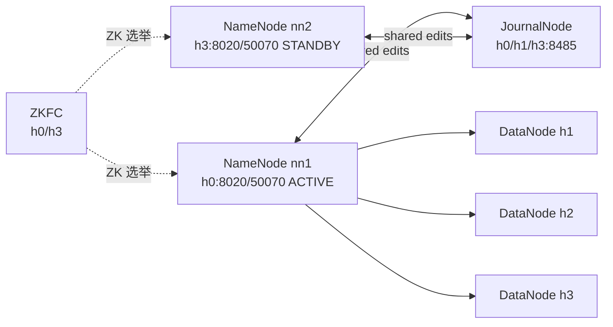
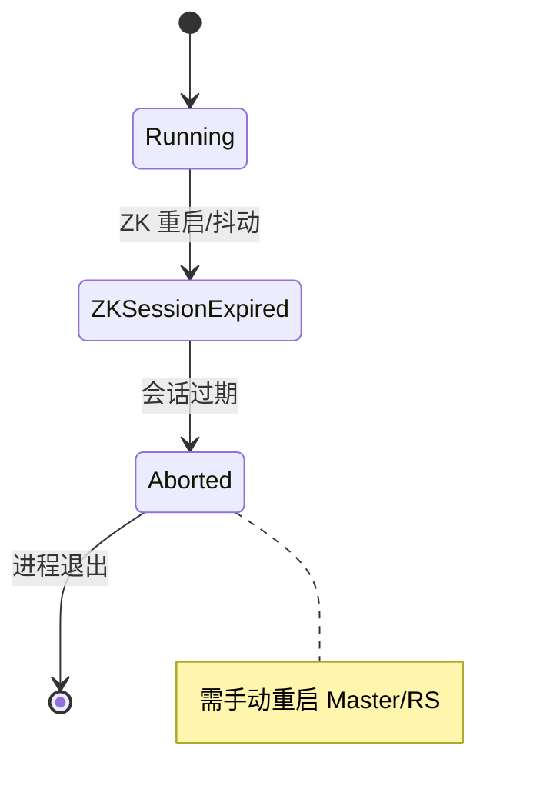
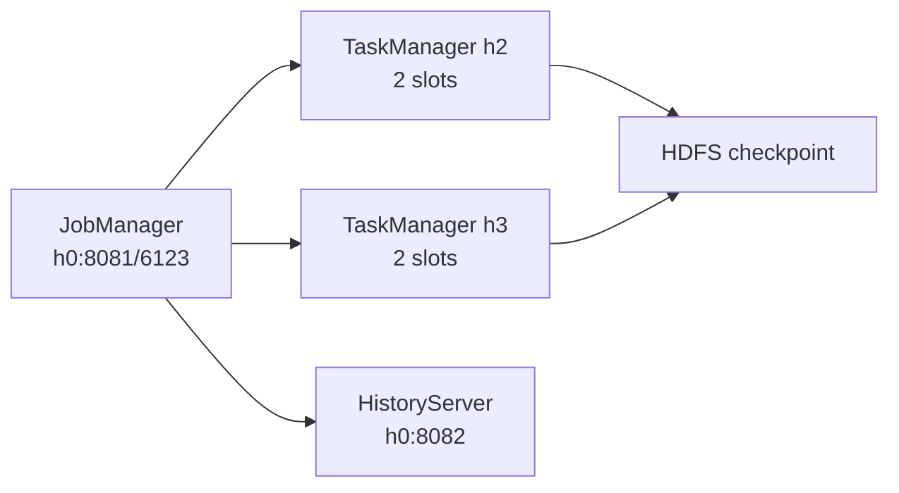
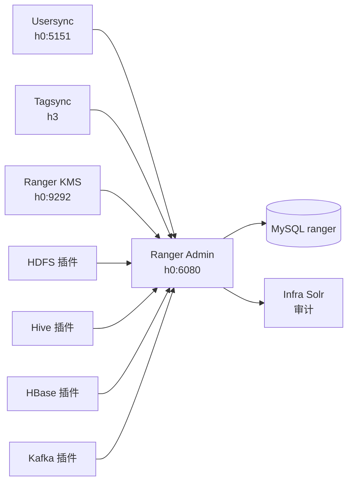

# 02 · 组件详解

> **状态提示（2026-11-26）**：本文为 v3.0 阶段手册；当前 Kerberos 架构、HA 与端口以
> [`../ARCHITECTURE.md`](../ARCHITECTURE.md) 和 [`../CURRENT_STATE.md`](../CURRENT_STATE.md) 为准。


> 版本：v3.0 · 2026-11-09  
> 读者：运维、开发  
> 说明：每个组件覆盖「职责 → 部署 → 关键配置 → 限制 → 最佳实践」  
> **v3.0 更新**：HDFS 2 NN + 3 JN + 2 ZKFC；Kafka 3 broker；Flink 20s；组件角色以 [10 · HA 与业务联通验收](10-ha-and-business-connectivity.md) 为准。

---

## 目录

1. [HDFS](#1-hdfs)
2. [YARN](#2-yarn)
3. [Hive](#3-hive)
4. [HBase](#4-hbase)
5. [Kafka](#5-kafka)
6. [Spark](#6-spark)
7. [Flink](#7-flink)
8. [ZooKeeper](#8-zookeeper)
9. [Apache Iceberg](#9-apache-iceberg)
10. [Ranger](#10-ranger)
11. [AMS](#11-ams)
12. [Prometheus / Grafana](#12-prometheus--grafana)

---

## 1. HDFS

### 1.1 职责

分布式文件系统，为 Iceberg、HBase、YARN、Flink checkpoint 提供底层存储。

### 1.2 部署



### 1.3 关键配置（实测）

| 配置 | 值 | 说明 |
|---|---|---|
| `dfs.replication` | 3 | 3 副本 |
| `dfs.namenode.name.dir` | `/var/lib/hadoop-hdfs/cache/hdfs/dfs/name` | NN 元数据 |
| `dfs.datanode.data.dir` | `/var/lib/hadoop-hdfs/cache/hdfs/dfs/data` | DN 数据 |
| `dfs.namenode.heartbeat.recheck-interval` | 300000 | 心跳 |
| `hadoop.zk.address` | h0/h1/h2:2181 | HA 协调 |
| `dfs.nameservices` | `qixuandata` | 生产 nameservice |
| `dfs.ha.namenodes.qixuandata` | `nn1,nn2` | 2 NameNode |
| `dfs.ha.automatic-failover.enabled` | `true` | 自动切换 |
| `fs.defaultFS` | `hdfs://qixuandata` | 生产默认 FS |
| 旧 authority | `hdfs://bigtop-hostname0.bigtop.apache.org:8020` | 仅回滚读取 |

### 1.4 容量（实测）

| 指标 | 值 |
|---|---|
| 配置容量 | 1.2 TB |
| DFS 已用 | 79.1 GB (6.40%) |
| 非 DFS 已用 | 585.4 GB (47.34%) |
| 剩余 | 46.26% |
| 缺失块 | 0 |
| 副本不足块 | 1（0.0026%，自愈中） |

### 1.5 限制与最佳实践

| 限制 | 说明 |
|---|---|
| NameNode HA | 已启用 2 NN + 3 JN + 2 ZKFC；旧 authority 仅回滚读取 |
| Router 挂载表为空 | Federation 未启用实际路由 |
| WebHDFS 主机名敏感 | 下划线非法，需用 FQDN |

**最佳实践**：
- 生产客户端统一使用 `hdfs://qixuandata`，不要硬编码 h0 authority
- 小文件合并（Iceberg 侧治理）
- 避免 `hdfs dfs -put` 超大文件不切分
- 定期 `fsck` 检查

---

## 2. YARN

### 2.1 职责

集群资源管理与作业调度，为 Spark/MapReduce 提供容器。

### 2.2 部署

| 组件 | 节点 | 端口 |
|---|---|---|
| ResourceManager | h0 | 8088/8050/8030 |
| NodeManager | h1/h2/h3 | 8042 |
| AppTimelineServer | h1 | 8188/10200 |
| TimelineReader(V2) | h0 | 8198 |
| RegistryDNS | h0 | 8670 |

### 2.3 关键配置

| 配置 | 值 |
|---|---|
| `yarn.nodemanager.resource.memory-mb` | 6144 |
| `yarn.nodemanager.resource.cpu-vcores` | 6 |
| `yarn.scheduler.maximum-allocation-mb` | 8192 |
| `yarn.resourcemanager.ha.enabled` | false |
| 队列 | default（单队列） |

### 2.4 限制

- 单 RM（无 HA）
- 单队列，无多租户隔离
- TimelineReader 依赖外部 HBase

**最佳实践**：按业务建队列；NM 内存与容器内存匹配；避免小容器碎片。

---

## 3. Hive

### 3.1 职责

数据仓库 SQL 引擎，提供 HiveServer2（JDBC）与 Metastore（元数据）。

### 3.2 部署

| 组件 | 节点 | 端口 |
|---|---|---|
| HiveServer2 | h0 | 10000/10002 |
| Hive Metastore | h0 | 9083 |
| WebHCat | h0 | 50111 |
| HCAT | h1/h2/h3 | — |

### 3.3 关键配置（实测）

| 配置 | 值 |
|---|---|
| `javax.jdo.option.ConnectionURL` | `jdbc:mysql://bigtop-hostname0.bigtop.apache.org/hive` |
| `javax.jdo.option.ConnectionDriverName` | `com.mysql.cj.jdbc.Driver` |
| `hive.metastore.uris` | `thrift://bigtop-hostname0.bigtop.apache.org:9083` |
| `hive.execution.engine` | `mr`（可切 tez/spark） |
| 元数据库 | MySQL（**非 Derby**） |

> ⚠️ 常见误区：启动日志出现 `derby*.jar` 仅是 classpath 依赖，实际元数据在 MySQL。

### 3.4 限制与最佳实践

| 限制 | 说明 |
|---|---|
| Hive 4.0.1 | 与 Iceberg HiveCatalog 不兼容（见 ADR-001） |
| 无 Iceberg runtime | Hive 直接查 Iceberg 表不可用（需补 runtime） |
| 单 HS2 | 无 HA |

**最佳实践**：
- 查询走 Spark ThriftServer（性能更好）
- Hive 用于元数据浏览、轻量 ETL
- 大表用 Tez/Spark 引擎

---

## 4. HBase

### 4.1 职责

NoSQL 列式数据库，适合随机读写、稀疏列、时序点查。

### 4.2 部署

| 组件 | 节点 | 端口 |
|---|---|---|
| HMaster | h0 | 16000/16010 |
| RegionServer | h3 | 16020/16030 |
| ZooKeeper | h0/h1/h2 | 2181 |

### 4.3 关键配置

| 配置 | 值 |
|---|---|
| `hbase.rootdir` | `hdfs://bigtop-hostname0.bigtop.apache.org:8020/apps/hbase/data` |
| `hbase.cluster.distributed` | true |
| `hbase.zookeeper.quorum` | h0/h1/h2 |
| `zookeeper.znode.parent` | `/hbase-unsecure` |
| `hbase.master.info.port` | 16010 |
| `hbase.regionserver.info.port` | 16030 |

### 4.4 限制与最佳实践

| 限制 | 说明 |
|---|---|
| 单 Master | 无 HA |
| 单 RS | 无副本，RS 故障数据不可用 |
| **ZK 会话敏感** | ZK 抖动会导致 HMaster Abort（历史多次） |

**最佳实践**：
- **避免单独重启 ZK**（会触发 HBase Abort）
- RowKey 设计避免热点（加盐/哈希前缀）
- 预分区
- 监控 `numDeadRegionServers`

### 4.5 故障模式（实测案例）



---

## 5. Kafka

### 5.1 职责

分布式消息队列，实时链路的数据源。

### 5.2 部署

| 组件 | 节点 | 端口 |
|---|---|---|
| Broker | h0 | 9092 |
| ZooKeeper | h0/h1/h2 | 2181 |

### 5.3 关键配置

| 配置 | 值 |
|---|---|
| `listeners` | `PLAINTEXT://bigtop-hostname0.bigtop.apache.org:9092` |
| `zookeeper.connect` | h0,h1,h2:2181 |
| `log.dirs` | `/kafka-logs` |
| `num.partitions` | 3 |
| `default.replication.factor` | 1 |

### 5.4 Topic 清单

| Topic | 分区 | RF | retention | 用途 |
|---|---|---|---|---|
| ai_inference_log | 3 | 1 | 30d | LLM 推理日志 |
| rag_query_log | 3 | 1 | 30d | RAG 检索日志 |
| learning_events | 3 | 1 | 7d | 学习事件 |
| edulake_dlq | 3 | 1 | 7d | 死信队列 |
| ods_orders_json | — | — | — | 示例 |
| student_profile_updates | — | — | — | 示例 |

### 5.5 限制与最佳实践

| 限制 | 说明 |
|---|---|
| RF=1 | Broker 故障丢消息 |
| 单 Broker | 无扩展性 |
| `localhost` 陷阱 | 容器内需用 FQDN |

**最佳实践**：
- 生产建议 RF≥2、≥3 broker
- 按分区数规划并行度
- 监控 consumer lag
- lz4 压缩需客户端支持

---

## 6. Spark

### 6.1 职责

内存计算引擎，提供 SQL（ThriftServer）、批处理、流处理。

### 6.2 部署

| 组件 | 节点 | 端口 |
|---|---|---|
| ThriftServer | h1 | 10016 |
| JobHistoryServer | h0 | 18081 |
| Client | h1/h2/h3 | — |

### 6.3 关键配置（实测）

| 配置 | 值 |
|---|---|
| `spark.sql.catalog.iceberg` | `org.apache.iceberg.spark.SparkCatalog` |
| `spark.sql.catalog.iceberg.type` | **hadoop** |
| `spark.sql.catalog.iceberg.warehouse` | `hdfs://.../iceberg-warehouse` |
| `spark.sql.session.timeZone` | **Asia/Shanghai** |
| `spark.sql.extensions` | `IcebergSparkSessionExtensions` |
| `spark.master` | yarn |

### 6.4 限制与最佳实践

| 限制 | 说明 |
|---|---|
| Hive client 2.3.9 | 与 HMS 4.0.1 不兼容（HiveCatalog 失败） |
| ThriftServer 单点 | 无 HA |
| 会话级 SET catalog 无效 | 需改 spark-defaults + 重启 |

**最佳实践**：
- 统一走 ThriftServer（连接池）
- Iceberg 维护（rewrite/expire）用 Spark
- 大查询调 executor 内存

---

## 7. Flink

### 7.1 职责

流处理引擎，实时入湖（Exactly-Once）。

### 7.2 部署



### 7.3 关键配置（实测）

| 配置 | 值 |
|---|---|
| `jobmanager.memory.process.size` | 1024m |
| `taskmanager.memory.process.size` | **2048m** |
| `taskmanager.numberOfTaskSlots` | **2** |
| `taskmanager.host` | **已移除**（多节点） |
| `table.local-time-zone` | **Asia/Shanghai** |
| `state.backend` | rocksdb |
| `state.checkpoints.dir` | `hdfs://qixuandata/flink-checkpoints/edulake` |
| `execution.checkpointing.interval` | **20s** |
| `execution.checkpointing.min-pause` | **10s** |
| `metrics.reporter.prom.port` | 9249 |

### 7.4 作业

| 作业 | 状态 | 源 → 目标 |
|---|---|---|
| edulake-realtime-ingest | RUNNING | 3 个 Kafka Source（ai_inference_log / rag_query_log / answer_sample_log）→ 3 个 Iceberg Sink（ods_llm_inference_log / ods_rag_query_log / rag_answer_samples） |

> 2026-11-08 复核：1 个作业、3 个 Sink；checkpoint completed=88、failed=0。

### 7.5 限制与最佳实践

| 限制 | 说明 |
|---|---|
| Standalone | 重启不自动恢复作业 |
| JM/TM lib 必须一致 | 否则 `Cannot load user class` |
| 非 shaded connector 冲突 | 只保留 `flink-sql-connector-kafka` |
| RocksDB 内置 | `flink-dist` 已含 native |

**最佳实践**：
- 提交前检查 `lib/` 一致性
- checkpoint 目录权限 1777
- 监控 9249
- 重启后手动提交（或后续配 HA）

---

## 8. ZooKeeper

### 8.1 职责

分布式协调：选主、配置、命名、锁。

### 8.2 部署

| 节点 | 端口 | 角色 |
|---|---|---|
| h0 | 2181/2888/3888 | Leader/Follower |
| h1 | 2181/2888/3888 | Follower |
| h2 | 2181/2888/3888 | Follower |

### 8.3 关键配置

| 配置 | 值 |
|---|---|
| `tickTime` | 2000 |
| `initLimit` | 10 |
| `syncLimit` | 5 |
| `dataDir` | `/var/lib/zookeeper` |
| `server.N` | h0/h1/h2 |

### 8.4 限制与最佳实践

| 限制 | 说明 |
|---|---|
| 单节点重启影响大 | HBase/Kafka 会话过期 |
| 无 Observer | 3 节点全参与投票 |

**最佳实践**：
- **避免生产期单独重启 ZK**
- 重启前评估 HBase/Kafka 影响
- 监控 `ruok` 与延迟

---

## 9. Apache Iceberg

### 9.1 职责

数据湖表格式：ACID、快照、时间旅行、Schema 演进。

### 9.2 部署与结构

- Catalog：hadoop（`/iceberg-warehouse`）
- 格式：v2，Parquet + zstd
- 分区：`dt`

### 9.3 库表

| 库 | 表数 | 说明 |
|---|---|---|
| edulake_ai | 4 | AI 域（ODS/DWD/DWS/ADS） |
| edulake_knowledge | 14 | 知识域 |
| edulake_learning | 28 | 学习域 |
| edulake_meta | 10 | 元数据域 |
| edulake_governance | 1 | 治理 |
| edulake_models | 4 | 模型 |
| edulake_pronunciation | 2 | 发音 |
| edulake_user | 2 | 用户 |

### 9.4 关键能力

| 能力 | 用法 |
|---|---|
| 快照 | `SELECT * FROM t.snapshots` |
| 时间旅行 | `SELECT * FROM t VERSION AS OF <id>` |
| 文件统计 | `SELECT * FROM t.files` |
| 小文件治理 | `rewrite_data_files` |
| 快照过期 | `expire_snapshots` |

### 9.5 限制与最佳实践

| 限制 | 说明 |
|---|---|
| hadoop catalog 无锁 | 单写者约束 |
| 小文件膨胀 | 流式写入必然，需定期治理 |
| 快照累积 | 需 expire |

**最佳实践**：每周 `iceberg-maintenance.sh`；ODS 仅 Flink 写。

---

## 10. Ranger

### 10.1 职责

集中式授权与审计。

### 10.2 部署



### 10.3 关键配置

| 项 | 值 |
|---|---|
| Admin URL | `http://bigtop-hostname0...:6080` |
| 用户 | admin / Admin1234! |
| 策略库 | MySQL `ranger` |
| 审计 | Infra Solr |
| 插件 | HDFS/Hive/HBase/Kafka |

### 10.4 限制与最佳实践

| 限制 | 说明 |
|---|---|
| 当前 allow-all | 需收敛 |
| 非 Kerberos | 认证弱 |
| 字段掩码 | P1 |

**最佳实践**：按库/表授权；开启审计；定期复核。

---

## 11. AMS

### 11.1 职责

Ambari Metrics Service，采集主机与组件指标。

### 11.2 部署（手工）

| 组件 | 节点 | 端口 |
|---|---|---|
| Collector | h0 | 6188 |
| Monitor | h0-h3 | — |
| ams-hbase | h0 | 61181/61300/61320 |

### 11.3 关键配置

| 项 | 值 |
|---|---|
| `metrics_servers` | bigtop_hostname0 |
| `hostname` | 各节点 FQDN |
| `send_interval` | 60s |
| 堆 | collector 512m |

### 11.4 限制与最佳实践

| 限制 | 说明 |
|---|---|
| 手工部署 | 未纳入 Ambari |
| 僵尸 PID | 启动脚本误判 |
| 依赖 python2 | monitor 需 py2 + psutil 编译 |

**最佳实践**：启动前清 PID；监控 6188；定期检查 monitor 进程。

---

## 12. Prometheus / Grafana

### 12.1 职责

Flink 指标采集与可视化。

### 12.2 部署

| 组件 | 位置 | 端口 |
|---|---|---|
| Prometheus | 宿主机 `/home/rkam/prometheus` | 9090 |
| Grafana | h0 容器 | 3000 |

### 12.3 配置

```yaml
# prometheus.yml
scrape_configs:
  - job_name: flink
    static_configs:
      - targets: ['172.19.0.2:9249']  # JM
      - targets: ['172.19.0.3:9249']  # TM h2
      - targets: ['172.19.0.4:9249']  # TM h3
```

### 12.4 Grafana

| 项 | 值 |
|---|---|
| 数据源 | Prometheus-Flink（`http://172.19.0.1:9090`） |
| Dashboard | Apache Flink (2021)，uid=`wKbnD5Gnk` |

### 12.5 限制与最佳实践

| 限制 | 说明 |
|---|---|
| 用户级部署 | 无 systemd，cron @reboot |
| 无告警规则 | 用 cron 兜底 |

**最佳实践**：补充 alert rules；持久化数据；监控自身。
