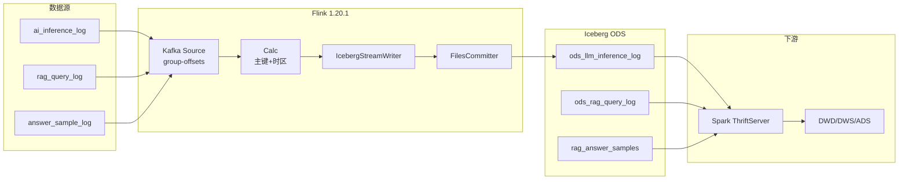
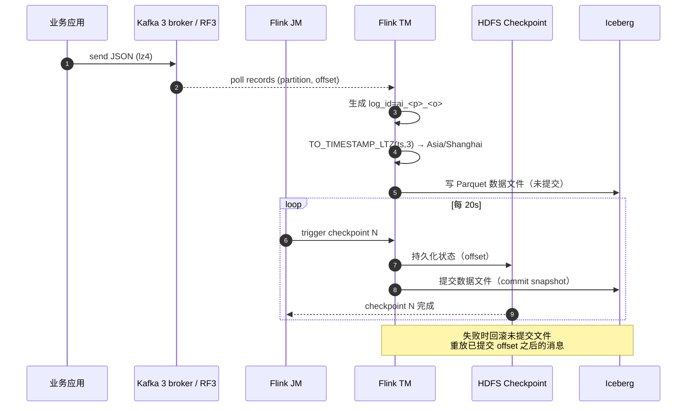
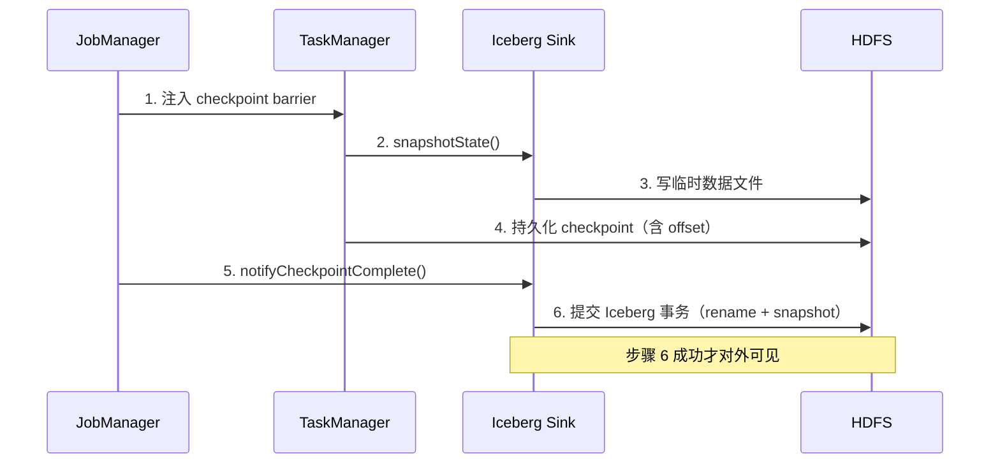
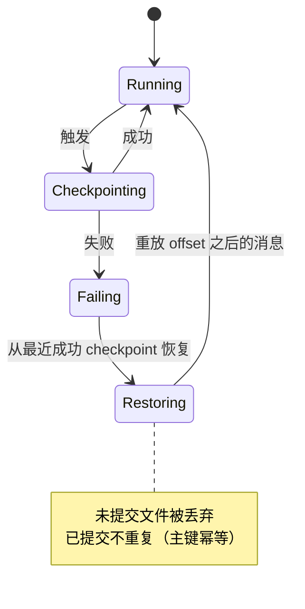
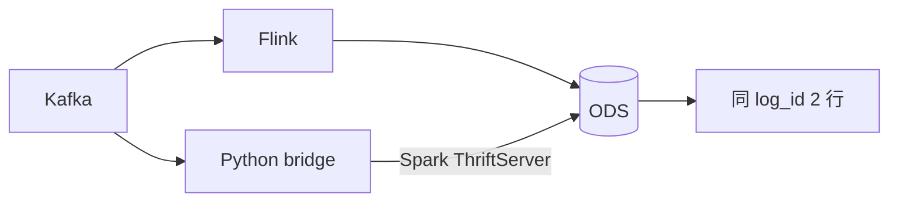
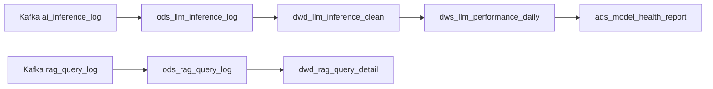

# 03 · 数据链路深度解析

> 版本：v3.0 · 2026-11-09  
> 读者：数据开发、架构  
> 说明：实时/离线链路原理、Exactly-Once 机制、幂等设计、故障分析  
> **v3.0 更新**：3 Source / 3 Sink、checkpoint 20s、实测 ≤25s、warehouse `-ha` 独立目录；详见 [10 · HA 与业务联通验收](10-ha-and-business-connectivity.md)。

---

## 1. 链路全景



---

## 2. 实时链路详解

### 2.1 端到端时序



### 2.2 Flink SQL 逐段解析

#### ① 执行配置

```sql
SET 'execution.runtime-mode' = 'streaming';
SET 'execution.checkpointing.interval' = '20s';
SET 'execution.checkpointing.mode' = 'EXACTLY_ONCE';
SET 'execution.checkpointing.min-pause' = '10s';
SET 'execution.checkpointing.timeout' = '10min';
SET 'state.backend' = 'rocksdb';
SET 'state.checkpoints.dir' = 'hdfs://qixuandata/flink-checkpoints/edulake';
SET 'table.local-time-zone' = 'Asia/Shanghai';
```

| 参数 | 作用 | 调优建议 |
|---|---|---|
| `interval=20s` | checkpoint 周期（2026-11-09 修正 `SqlJob.class` 硬编码 60s） | 延迟 45s→**≤25s** |
| `min-pause=10s` | 两次 checkpoint 最小间隔（2026-11-09 由 30s 修正） | 避免连续触发 |
| `timeout=10min` | 超时 | 大状态可调大 |
| `rocksdb` | 状态后端 | 大状态必备 |

#### ② Catalog

```sql
CREATE CATALOG iceberg WITH (
  'type' = 'iceberg',
  'catalog-type' = 'hadoop',      -- 关键：非 hive
  'warehouse' = 'hdfs://qixuandata/iceberg-warehouse-ha',
  'hadoop-conf-dir' = '/etc/hadoop/conf'
);
```

> 为什么是 hadoop：Hive 4.0.1 HMS 移除 `get_table_objects_by_name`（ADR-001）。

#### ③ Kafka Source

```sql
CREATE TEMPORARY TABLE kafka_ai_inference_src (
  ...,
  kafka_partition INT METADATA FROM 'partition' VIRTUAL,
  kafka_offset    BIGINT METADATA FROM 'offset' VIRTUAL
) WITH (
  'connector' = 'kafka',
  'topic' = 'ai_inference_log',
  'properties.bootstrap.servers' = 'bigtop-hostname0.bigtop.apache.org:9092',
  'properties.group.id' = 'edulake_flink_ai_v3',
  'scan.startup.mode' = 'group-offsets',
  'properties.auto.offset.reset' = 'earliest',
  'format' = 'json',
  'json.ignore-parse-errors' = 'true'
);
```

| 参数 | 说明 |
|---|---|
| `METADATA FROM 'partition'/'offset'` | 提取 Kafka 元数据，用于幂等主键 |
| `group-offsets` | 从已提交 offset 继续 |
| `auto.offset.reset=earliest` | 新组从最早开始 |
| `ignore-parse-errors=true` | 脏数据跳过（建议配合 DLQ） |

#### ④ 幂等主键

```sql
CONCAT('ai_', CAST(kafka_partition AS STRING), '_', CAST(kafka_offset AS STRING)) AS log_id
```

**为什么不用 ts**：同一毫秒可能多条；partition+offset 全局唯一且重放不变。

#### ⑤ 时区与分区

```sql
CAST(TO_TIMESTAMP_LTZ(ts, 3) AS TIMESTAMP) AS request_at,
DATE_FORMAT(CAST(TO_TIMESTAMP_LTZ(ts, 3) AS TIMESTAMP), 'yyyy-MM-dd') AS dt
```

- `TO_TIMESTAMP_LTZ(ts,3)`：毫秒时间戳 → TIMESTAMP（带本地时区）
- `table.local-time-zone=Asia/Shanghai`：保证 dt 为本地日期
- **必须与 Spark 一致**，否则跨引擎 dt 错位

---

## 3. Exactly-Once 原理

### 3.1 两阶段提交



### 3.2 故障恢复



### 3.3 关键结论

| 场景 | 行为 |
|---|---|
| checkpoint 成功 | 数据可见，offset 提交 |
| checkpoint 失败 | 数据文件丢弃，重放 |
| 作业重启 | 从 checkpoint/committed offset 恢复 |
| 重复消费 | 主键相同，下游可去重 |

> **注意**：Exactly-Once 保证"不丢不重"的前提是 **Sink 支持事务**（Iceberg 支持）。若同时有第二个写入方（如 bridge），仍会重复。

---

## 4. 故障分析（实战）

### 4.1 双写导致重复



**现象**：`ai_1_2` 2 行；Iceberg snapshot 显示 `flink` 与 `spark` 交替。
**根因**：bridge 与 Flink 同时写（违反单写者）。
**解决**：停 bridge + `MERGE` 去重。

### 4.2 TM 缺 connector

**现象**：作业 `RESTARTING`，异常 `Cannot load user class: KafkaSource`。
**根因**：TM（h2/h3）`/usr/lib/flink/lib/` 无 `flink-sql-connector-kafka`。
**解决**：同步 JAR 到所有 TM，重启。

### 4.3 类冲突

**现象**：`ClassNotFoundException: OffsetResetStrategy`。
**根因**：非 shaded `flink-connector-kafka` 与 shaded `flink-sql-connector-kafka` 并存。
**解决**：移除前者。

---

## 5. 离线链路

### 5.1 典型 ETL


### 5.2 调度

| 方式 | 说明 |
|---|---|
| Spark 定时任务 | cron/调度器 |
| Hive 定时 | 同上 |
| 维护任务 | 每周 Iceberg 治理 |

---

## 6. 数据血缘（示例）



| 层 | 表 | 写入方 | 更新频率 |
|---|---|---|---|
| ODS | ods_llm_inference_log | Flink | 实时（≤30s，实测 ≤25s） |
| ODS | ods_rag_query_log | Flink | 实时（≤30s，实测 ≤25s） |
| ODS | rag_answer_samples | Flink | 实时（≤30s，实测 ≤25s） |
| DWD | dwd_llm_inference_log | Spark | 日 |
| DWS | dws_llm_performance_daily | Spark | 日 |
| ADS | ads_model_health_report | Spark | 日 |

---

## 7. 端到端验证命令

```bash
# 1. 发送测试消息（三 broker 任选其一）
echo '{"user_id_hash":"e2e","session_id":"s1","model_name":"m","token_in":1,"token_out":2,"latency_ms":100,"ttft_ms":50,"tok_per_sec":1.0,"temperature":0.7,"response_ok":true,"error_msg":"","ts":'$(date +%s%3N)'}' \
 | kafka-console-producer.sh --bootstrap-server bigtop-hostname0.bigtop.apache.org:9092 --topic ai_inference_log

# 2. 等待 ≤30s 后校验（实测 ≤25s）
beeline -u 'jdbc:hive2://bigtop-hostname1.bigtop.apache.org:10016/default;transportMode=binary' -n spark -e "
SET spark.sql.catalog.newice=org.apache.iceberg.spark.SparkCatalog;
SET spark.sql.catalog.newice.type=hadoop;
SET spark.sql.catalog.newice.warehouse=hdfs://qixuandata/iceberg-warehouse-ha;
SELECT log_id, dt, count(*) FROM newice.edulake_ai.ods_llm_inference_log GROUP BY log_id, dt ORDER BY dt DESC LIMIT 3;"

# 3. 检查重复
# 期望：每个 log_id count=1
```

---

## 8. 链路 SLA

| 指标 | 目标 | 当前 |
|---|---|---|
| 端到端延迟 | ≤30s | **实测 ≤25s（三链路）** |
| 数据不丢 | Exactly-Once | ✅ |
| 重复率 | 0 | ✅ |
| checkpoint 成功率 | >99% | 稳定 |
| Kafka lag | 0 | ✅ |
