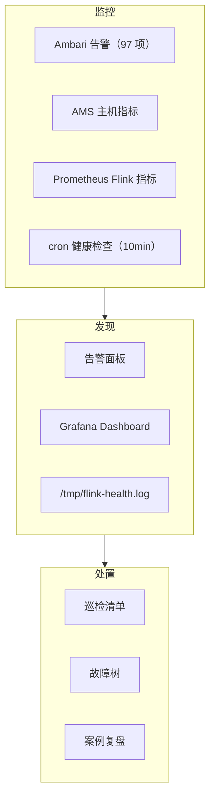
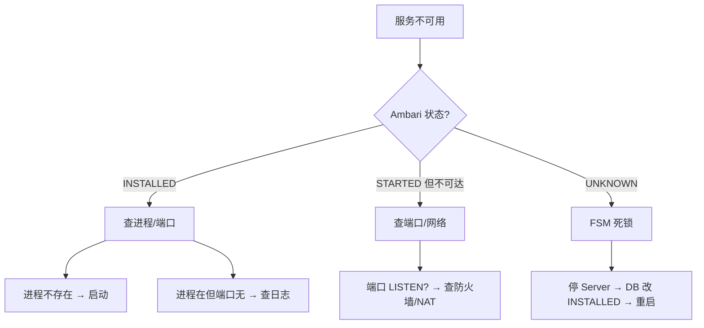
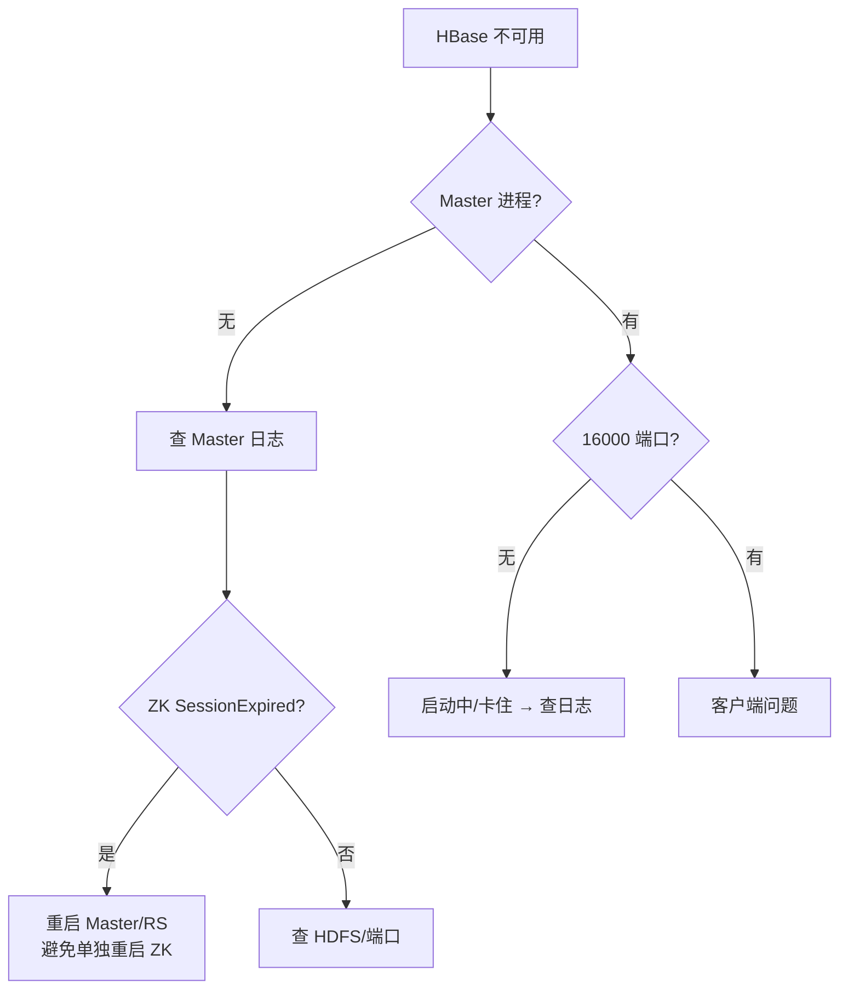
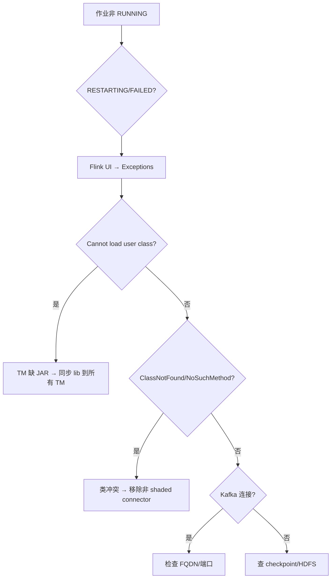
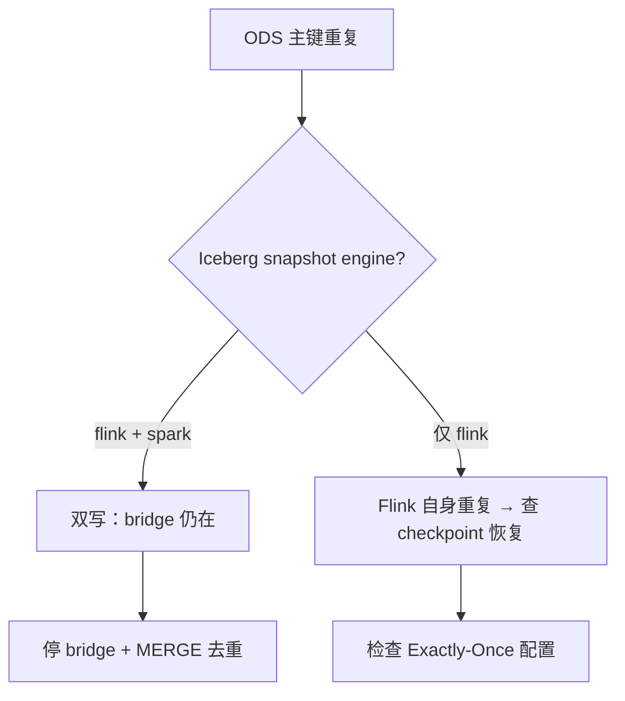
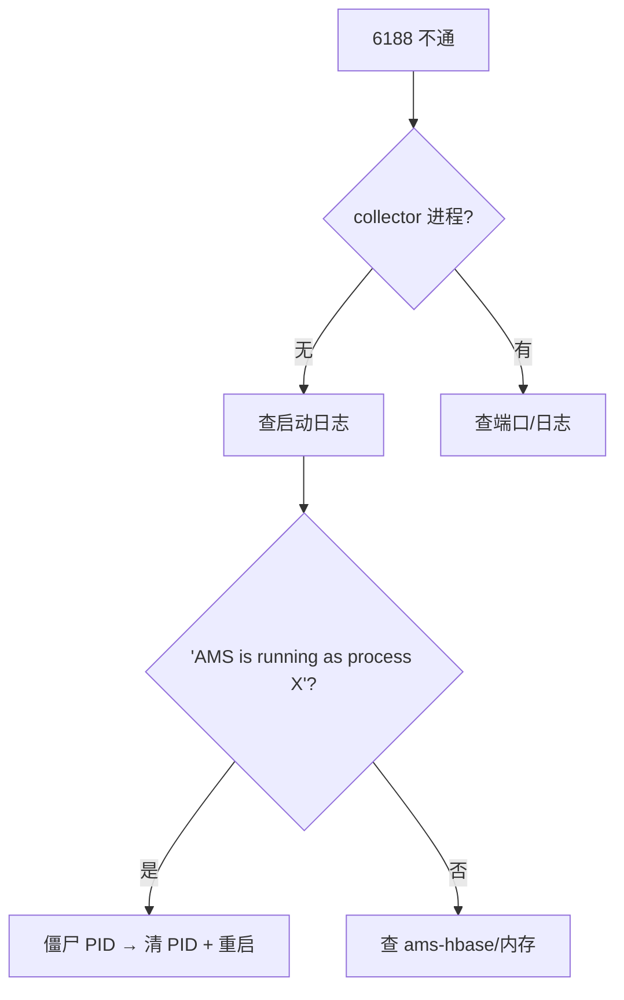

# 05 · 运维手册（故障树与实战复盘）

> **状态提示（2026-11-26）**：本文为 v3.0 阶段手册；当前 Kerberos 架构、HA 与端口以
> [`../ARCHITECTURE.md`](../ARCHITECTURE.md) 和 [`../CURRENT_STATE.md`](../CURRENT_STATE.md) 为准。


> 版本：v3.0 · 2026-11-09  
> 读者：平台运维  
> 配套脚本：`ambari3/scripts/flink-health-check.sh`、`flink-alert-cron.sh`、`iceberg-maintenance.sh`、`setup-nat-forward.sh`、`scripts/ambari_reset_ha_wizard.sh`  
> **v3.0 更新**：HDFS NN HA 巡检、Kafka RF3、Flink 20s、磁盘告警阈值 70/80、HiveServer2 恢复、Ambari step9 残留清理、NVMe 风险。

---

## 1. 运维体系



---

## 2. 巡检体系

### 2.1 每日（10 分钟）

| 检查 | 命令 | 期望 |
|---|---|---|
| 服务 | Ambari UI | 12 STARTED |
| 告警 | Ambari | 非 OK = 0 |
| 主机 | Ambari | 4 HEALTHY |
| Flink | `flink-health-check.sh` | 9/9 PASS |
| 端口 | 关键端口 | LISTEN |
| 内存/Swap | `free -m` | avail>8GB, swap<80% |
| 磁盘 | `df -h` | <80% |

### 2.2 每周

| 检查 | 命令 |
|---|---|
| Iceberg 小文件 | `iceberg-maintenance.sh --dry-run` |
| checkpoint 历史 | Flink UI |
| Kafka lag | consumer-groups |
| 数据重复 | SQL group by |
| 备份校验 | HDFS 快照 |

### 2.3 每月

- 容量评估（HDFS/磁盘）
- 权限复核（Ranger）
- 配置基线对比
- 文档更新

---

### 2.4 HA 专项巡检（2026-11-09 新增）

| 检查 | 命令 | 期望 |
|---|---|---|
| NameNode 角色 | `hdfs haadmin -getAllServiceState` | 1 Active + 1 Standby |
| JournalNode | `ss -ltn \| grep 8485`（h0/h1/h3） | 3/3 LISTEN |
| ZKFC | Ambari HDFS Summary | 2/2 Started |
| HDFS 健康 | `hdfs fsck /` | HEALTHY，0 missing/corrupt |
| Kafka 副本 | `kafka-topics.sh --describe` | 68/68 RF3 + ISR3 |
| Kafka lag | `kafka-consumer-groups.sh --describe` | 0 |
| Flink checkpoint | Flink REST `/checkpoints` | completed 增长，failed=0 |
| Iceberg 表数 | `hdfs dfs -ls .../<db>` | 70 |
| 业务探针 | 三 topic 各发 1 条 | ≤30s 可见 |
| Ambari 告警 | Alerts 页面 | 0 CRITICAL |
| 磁盘 | `df -h /usr/bigtop` | <70% warning / <80% critical |
| NVMe | `dmesg -T \| grep nvme` | 无新增 timeout |

**HA 切换命令**：

```bash
# 查看角色
hdfs haadmin -getAllServiceState

# h3 → h0 回切（示例）
hdfs haadmin -failover nn2 nn1

# 只读检查（不要在 Active 未 fencing 时强制切换）
hdfs dfs -ls hdfs://qixuandata/iceberg-warehouse-ha
hdfs dfs -ls hdfs://bigtop-hostname0.bigtop.apache.org:8020/iceberg-warehouse
```

**告警阈值基线**：

- `ambari_agent_disk_usage`：WARNING **70%**，CRITICAL **80%**。
- 4 个容器共享宿主机 overlay，同一磁盘条件会被 4 个 host 各报一次；看到 4 条同源告警时先看 `df -h /usr/bigtop`，不要误判为 4 块盘。

---

## 3. 故障树

### 3.1 服务不可用



### 3.2 HBase 不可用



### 3.3 Flink 作业异常



### 3.4 数据重复



### 3.5 AMS 不可用



---

## 4. 实战案例复盘

### 案例 1：HBase 因 ZK 会话过期 Abort（2026-11-03）

| 项 | 内容 |
|---|---|
| **现象** | HBASE 服务 INSTALLED；16000/16020 无监听 |
| **日志** | `ZKWatcher ... SessionExpiredException for /hbase-unsecure/master` → `HMaster Aborted` |
| **根因** | ZK 抖动/重启导致 HBase 会话过期；HBase 设计为 Abort 而非重连 |
| **处置** | 重启 HBASE_MASTER@h0、HBASE_REGIONSERVER@h3 |
| **预防** | 避免单独重启 ZK；监控 ZK 延迟；调大 `zookeeper.session.timeout` |
| **复核** | 2026-11-04：已恢复，Alerts 0；建议增加 HBase watchdog（见 BUG-032） |
| **教训** | 重启 ZK 前评估 HBase/Kafka 影响 |

### 案例 2：Flink 与 bridge 双写（2026-11-03）

| 项 | 内容 |
|---|---|
| **现象** | 同 log_id 2 行 |
| **证据** | Iceberg snapshot `engine-name` flink/spark 交替 |
| **根因** | bridge（168）与 Flink 同时写 ODS |
| **处置** | 业务方停 bridge + MERGE 去重 |
| **预防** | 单写者约束；health-check 检查 bridge |
| **教训** | 切换必须二选一 |

### 案例 3：TM 缺 Kafka connector（2026-11-03）

| 项 | 内容 |
|---|---|
| **现象** | 作业 RESTARTING |
| **异常** | `Cannot load user class: org.apache.flink.connector.kafka.source.KafkaSource` |
| **根因** | h2/h3 TM 的 lib 无 `flink-sql-connector-kafka`（仅 JM 有） |
| **处置** | 复制 JAR 到所有 TM，重启 |
| **预防** | 提交前检查 JM/TM lib 一致性 |
| **教训** | Flink Standalone 的 lib 必须全节点一致 |

### 案例 4：AMS collector 僵尸 PID（2026-11-03）

| 项 | 内容 |
|---|---|
| **现象** | 6188 不通 |
| **日志** | `AMS is running as process 640396. Exiting` |
| **根因** | 旧 PID 文件残留，启动脚本误判 |
| **处置** | 清 PID + 直接 java 启动 |
| **预防** | 启动前清 PID；监控 6188 |

### 案例 5：Ranger TagSync 堆参数冲突导致 host3 ALERT（2026-11-04）

| 项 | 内容 |
|---|---|
| **现象** | Ambari Hosts 中 host3 橙色 ALERT；组件 Ranger Tagsync 红色 |
| **日志** | `Initial heap size set to a larger value than the maximum heap size` |
| **根因** | `ranger-tagsync-env.sh` 设 `Xmx=512m`，启动脚本固定 `-Xms1g`；且 conf 下 `.bak` 被 `find` 一并 source，覆盖回 512m |
| **处置** | `ranger_tagsync_max_heap_size=1g`、移除 `.bak`、启动 TagSync |
| **预防** | 配置文件备份勿放在 conf 目录；纳入 BUG-042 |

### 案例 6：批量配置合并错乱（2026-11-03）

| 项 | 内容 |
|---|---|
| **现象** | hbase-env 被写入所有配置字段 |
| **根因** | Ambari 批量 `desired_configs` 合并 bug |
| **处置** | 逐个 type 提交 |
| **预防** | 配置变更一次一个 type |

### 案例 7：Ambari 登录强制跳转 HA Wizard step9（2026-11-09）

| 项 | 内容 |
|---|---|
| **现象** | 全新浏览器/全新机器登录 `http://<ambari>/` 仍落到 `highAvailability/NameNode/enable/step9` |
| **根因** | 服务端按用户持久化 `CLUSTER_CURRENT_STATUS` 仍为 `HIGH_AVAILABILITY_DEPLOY` + `wizardControllerName=highAvailabilityWizardController` + `currentStep=9` |
| **处置** | 重置为 `CLUSTER_INSTALLED_4`，移除向导字段；清理 `wizard-data` |
| **脚本** | `scripts/ambari_reset_ha_wizard.sh` |
| **注意** | 执行前关闭仍停留在 step9 的旧标签页；不要点 **YES**（会回滚 HA） |

### 案例 8：HiveServer2 卡在 shutdown，10000 端口未监听（2026-11-09）

| 项 | 内容 |
|---|---|
| **现象** | Ambari `hive_server_process` CRITICAL；进程存在但 10000 无监听 |
| **根因** | 进程卡在 shutdown 流程，未真正退出 |
| **处置** | `kill -9` 卡死进程 → Ambari `INSTALLED` → `STARTED` |
| **验证** | `ss -ltn \| grep 10000`、`beeline ... SELECT 1` |
| **预防** | 监控 10000；重启前先确认进程已退出 |

### 案例 9：4 条磁盘告警同源（2026-11-09）

| 项 | 内容 |
|---|---|
| **现象** | h0/h1/h2/h3 各 1 条 `ambari_agent_disk_usage` |
| **根因** | 4 个容器共享宿主机 overlay，同一 `/usr/bigtop` 磁盘被 4 个 host 各报一次 |
| **处置** | WARNING 阈值 50% → 70%，CRITICAL 保持 80%；告警 97 OK |
| **预防** | 看到 4 条同源告警先看 `df -h`，不要误判为 4 块盘 |

### 案例 10：NVMe I/O timeout 触发 NN 退出（2026-11-09）

| 项 | 内容 |
|---|---|
| **现象** | `dmesg` 多次 `nvme nvme0: I/O timeout`；h0 NameNode 退出，h3 自动接管 |
| **根因** | 宿主机 NVMe 周期性 I/O timeout，备份重 I/O 为触发源 |
| **处置** | 重启 NN，切回 h0 Active；nameservice 路径业务无感 |
| **预防** | NVMe SMART/更换；备份 `ionice` + `rsync --bwlimit`；避开高峰 |

---

## 5. 变更管理


**变更前备份**：
```bash
# Ambari 配置
curl -s -u "$AMBARI_USER:$AMBARI_PASS" -H 'X-Requested-By: ambari' \
  'http://localhost:20609/api/v1/clusters/qixuandata/configurations?type=flink-conf' > /tmp/flink-conf-backup.json
# JVM 配置
docker exec bigtop_hostname0 cp /etc/flink/conf/flink-conf.yaml /root/backup/
```

---

## 6. 备份与恢复

| 对象 | 方式 | 恢复 |
|---|---|---|
| Iceberg 数据 | 快照 | `VERSION AS OF` / rollback |
| Ambari 配置 | 配置版本 | 回滚版本 |
| Flink 状态 | checkpoint | `-s` 恢复 |
| bridge | 消费组 offset | reset-offsets |
| MySQL | mysqldump | 导入 |

```bash
# MySQL 备份
docker exec bigtop_hostname0 mysqldump -u root ambari > /backup/ambari.sql
docker exec bigtop_hostname0 mysqldump -u root hive > /backup/hive.sql
```

---

## 7. 应急手册（P0）

### 7.1 全站不可用

```bash
# 1) 容器
docker ps -a --filter name=bigtop_hostname
# 2) Ambari
curl -s -o /dev/null -w '%{http_code}' http://localhost:20609/api/v1/clusters/qixuandata
# 3) 网络
ip a; iptables -t nat -L -n
# 4) 按依赖顺序启动：MySQL → Ambari → Agent → ZK → HDFS → YARN → HBase → 其他
```

### 7.2 数据链路中断

```bash
# 1) Flink 作业
curl -s http://localhost:8081/jobs/overview
# 2) Kafka
kafka-consumer-groups.sh --bootstrap-server ... --describe --group edulake_flink_ai_v3
# 3) 重新提交
docker exec bigtop_hostname0 bash -c 'su -s /bin/bash flink -c "... sql-client.sh ..."'
```

### 7.3 磁盘满

```bash
hdfs dfs -du -h / | sort -k2 -h | tail
# 清理：Iceberg expire/rewrite、旧日志、临时文件
```

---

## 8. 责任边界

| 事项 | 平台 | 业务 |
|---|---|---|
| Flink 作业提交/恢复 | ✅ | 提供 SQL |
| Iceberg 治理 | ✅ | 确认窗口 |
| bridge 启停 | 配合 | ✅（168） |
| ODS 数据口径 | 配合 | ✅ |
| Spark 下游 | 配合 | ✅ |
| 权限审批 | ✅ | 申请 |
