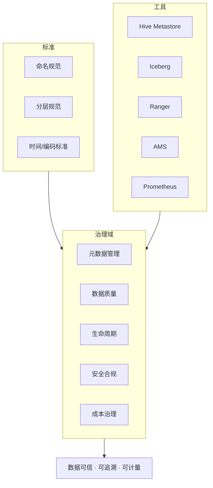
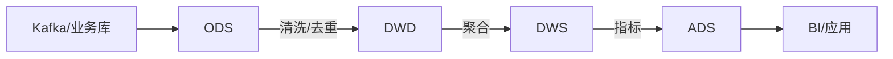
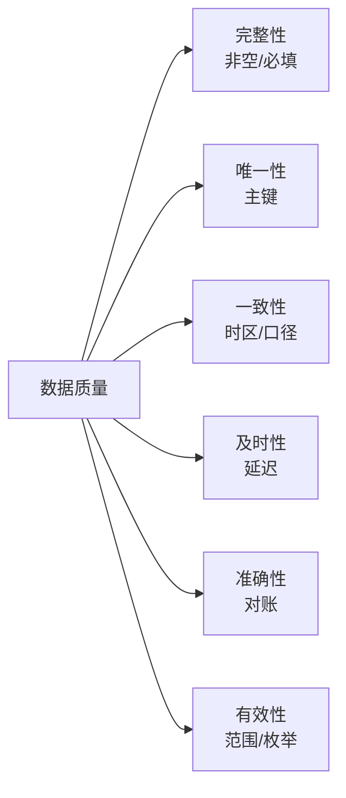
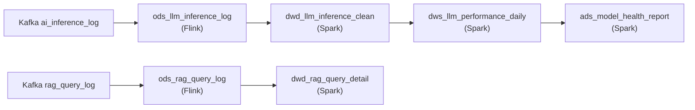
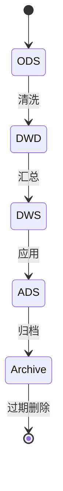

# 06 · 数据治理体系

> 版本：v3.0 · 2026-11-09  
> 读者：数据治理、数据开发、架构  
> **v3.0 更新**：Iceberg 70 表迁移到 `-ha` 独立目录；旧仓库保留；分层与质量规则不变。

---

## 1. 治理框架



---

## 2. 数据分层

### 2.1 分层定义

| 层 | 全称 | 职责 | 写入方 | 更新 |
|---|---|---|---|---|
| ODS | Operational Data Store | 贴源、保留原始 | **Flink** | 实时 |
| DWD | Data Warehouse Detail | 清洗、标准化、去重 | **Spark** | 日 |
| DWS | Data Warehouse Summary | 主题汇总 | **Spark** | 日 |
| ADS | Application Data Service | 面向应用 | **Spark** | 日/实时 |

### 2.2 分层流转



### 2.3 各层规范

| 层 | 表命名 | 分区 | 保留 | 压缩 |
|---|---|---|---|---|
| ODS | `ods_<业务>_<对象>` | dt | 30-90 天 | parquet+zstd |
| DWD | `dwd_<域>_<实体>` | dt | 1 年 | parquet+zstd |
| DWS | `dws_<主题>_<粒度>` | dt | 1-3 年 | parquet+zstd |
| ADS | `ads_<应用>_<指标>` | dt/无 | 按需 | parquet+zstd |

---

## 3. 元数据管理

### 3.1 元数据来源

| 类型 | 存储 | 内容 |
|---|---|---|
| 技术元数据 | Hive Metastore（MySQL） | 库、表、字段、分区 |
| 表格式元数据 | Iceberg `metadata/` | schema、快照、manifest |
| 业务元数据 | 文档/字典 | 指标口径、负责人 |
| 操作元数据 | Ambari/日志 | 作业、调度、变更 |

### 3.2 元数据查询

```sql
-- 库表清单
SHOW DATABASES IN newice;
SHOW TABLES IN newice.edulake_ai;

-- 表结构
DESCRIBE newice.edulake_ai.ods_llm_inference_log;

-- Iceberg 快照
SELECT snapshot_id, committed_at, operation, summary
FROM newice.edulake_ai.ods_llm_inference_log.snapshots;
```

### 3.3 元数据规范

- 每张表必须有 `COMMENT`
- 关键字段必须有注释
- 表 owner 明确
- 变更留痕（CHANGELOG）

---

## 4. 数据质量

### 4.1 质量维度



### 4.2 质量规则（示例）

| 表 | 规则 | 校验 SQL |
|---|---|---|
| ods_llm | 主键唯一 | `GROUP BY log_id HAVING count(*)>1` |
| ods_llm | dt 非空 | `WHERE dt IS NULL` |
| ods_llm | request_at 合理 | `WHERE request_at > now()` |
| ods_rag | query_len>0 | `WHERE query_len<=0` |
| 全部 | 与 Kafka offset 对账 | 行数 vs offset 差 |

### 4.3 质量监控

```sql
-- 每日质量报告
SELECT 'llm' t, count(*) rows, count(distinct log_id) uniq,
       sum(case when dt is null then 1 else 0 end) null_dt
FROM newice.edulake_ai.ods_llm_inference_log
UNION ALL
SELECT 'rag', count(*), count(distinct query_id),
       sum(case when dt is null then 1 else 0 end)
FROM newice.edulake_knowledge.ods_rag_query_log;
```

| 指标 | 阈值 | 动作 |
|---|---|---|
| 重复率 | >0 | 告警 |
| null_dt | >0 | 告警 |
| 行数骤降 | <昨日 50% | 告警 |
| 延迟 | >120s | 告警 |

### 4.4 坏数据处理

- Flink `json.ignore-parse-errors=true` 会静默丢弃
- **建议**：接入 DLQ（`edulake_dlq`），记录原始消息 + 错误原因
- 监控：Kafka offset 差 vs ODS 行数差

---

## 5. 数据血缘



| 血缘信息 | 记录方式 |
|---|---|
| 表级 | 文档/元数据表 |
| 字段级 | 建议引入 Atlas（P1） |
| 作业级 | Flink/Spark UI |

---

## 6. 生命周期管理

### 6.1 数据生命周期



### 6.2 Iceberg 小文件治理

**问题**：流式写入每 checkpoint 产生小文件（当前 ~4KB/个）。

**方案**：
```bash
# 每周
bash ambari3/scripts/iceberg-maintenance.sh --dry-run
bash ambari3/scripts/iceberg-maintenance.sh
```

| 操作 | 作用 |
|---|---|
| `rewrite_data_files` | 合并小文件（目标 128MB） |
| `expire_snapshots` | 清理旧快照（保留 3 个/7 天） |

**触发条件**：文件数 > 200 或平均 < 10MB。

### 6.3 快照与时间旅行

```sql
-- 保留策略：最近 3 个 + 7 天
CALL newice.system.expire_snapshots(
  table => 'edulake_ai.ods_llm_inference_log',
  older_than => TIMESTAMPADD(DAY,-7,CURRENT_TIMESTAMP),
  retain_last => 3);
```

### 6.4 归档

| 层 | 在线 | 归档 | 删除 |
|---|---|---|---|
| ODS | 30-90 天 | 1 年 | 按合规 |
| DWD | 1 年 | 3 年 | 按合规 |
| DWS | 1-3 年 | 长期 | — |
| ADS | 按需 | — | — |

---

## 7. SLA / SLO

| 链路 | SLI | SLO |
|---|---|---|
| 实时入湖 | 端到端延迟 | ≤30s（P95，实测 ≤25s） |
| 实时入湖 | 数据不丢 | 100% |
| 实时入湖 | 重复率 | 0 |
| 查询 | ThriftServer 可用性 | ≥99% |
| 存储 | HDFS 可用性 | ≥99.9% |
| 作业 | checkpoint 成功率 | ≥99% |

---

## 8. 成本治理

| 维度 | 现状 | 优化 |
|---|---|---|
| 存储 | HDFS 22.67GB/1.21TB（2.84%） | 小文件合并、快照过期 |
| 计算 | 4 容器共享 40GB | 堆调优、按需启停 |
| 消息 | RF=1 | 生产建议 RF≥2 |
| 实时 | 2 作业 4 slots | 按负载调整 |
| 许可 | 全开源 | — |

**JVM 调优（2026-11-03）**：h0 used 33.7→28.5GB、Swap 100%→43%；**2026-11-06 复核** Swap 回升至 ~100%，需按 08 章 P0 扩容/迁服务。

---

## 9. 数据标准

| 类别 | 标准 |
|---|---|
| 时间 | Asia/Shanghai；dt=yyyy-MM-dd |
| 金额 | decimal(18,2) |
| 用户标识 | SHA256 哈希 |
| 编码 | UTF-8 |
| 布尔 | true/false |
| 空值 | 明确 NULL 语义 |
| 枚举 | 字典表 |

---

## 10. 治理成熟度

| 能力 | 现状 | 目标 |
|---|---|---|
| 元数据 | ✅ HMS + Iceberg | 字段级血缘 |
| 质量 | 🟡 基础校验 | 规则引擎 + 告警 |
| 血缘 | 🟡 文档级 | Atlas 自动采集 |
| 生命周期 | ✅ 小文件/快照治理 | 自动归档 |
| 安全 | 🟡 Ranger allow-all | 最小权限 |
| 成本 | 🟡 手工 | 计量看板 |

---

## 11. 治理路线图


