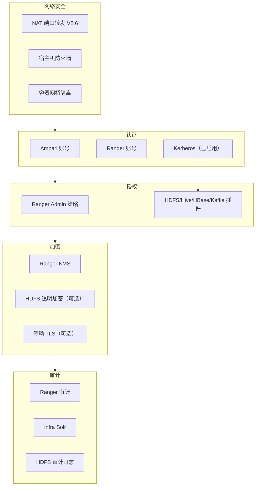

# 07 · 安全体系

> 版本：v3.0 · 2026-11-09  
> 读者：安全、运维、架构  
> **2026-11-26 更新**：HDFS/HBase/Hive/YARN/Flink/Kafka/Spark 已启用 Kerberos；Ambari `security_type=KERBEROS`；ZK/Ranger/KMS/TLS 仍未 Kerberos 化。当前架构见 [`../ARCHITECTURE.md`](../ARCHITECTURE.md)。

---

## 1. 安全架构



---

## 2. 认证

### 2.1 现状（2026-11-26）

| 层 | 机制 | 状态 |
|---|---|---|
| Ambari | 本地账号 admin | ✅ |
| Ranger Admin | 本地账号 | ✅（未 Kerberos） |
| HDFS | Kerberos RPC；NN/JN `_HOST`，DN 显式 FQDN | ✅ |
| HBase | Kerberos RPC | ✅ |
| Hive HMS/HS2 | Sasl/Kerberos | ✅ |
| YARN RM/NM | Kerberos + LinuxContainerExecutor | ✅ |
| Flink | keytab + ZK SASL 关闭 | ✅ |
| Kafka | SASL_PLAINTEXT/GSSAPI | ✅ |
| Spark ThriftServer | Kerberos principal/keytab | ✅ |
| ZooKeeper | 仍 simple；客户端关闭 SASL | ⚠️ |
| Ranger KMS | 未 Kerberos；客户端已移除 KMS provider | ⚠️ |
| TLS | 未启用；Kafka 为 SASL_PLAINTEXT | ⚠️ |

### 2.2 认证链路

- KDC：h0/h3 `HODOOPFORGE.LOCAL`；
- 服务端：`nn/jn/dn/rm/nm/hbase/hive/spark/flink/kafka` keytab；
- 客户端：HDFS/HBase/Hive/Spark/Kafka 必须 `kinit` 或 keytab；
- Ambari：`security_type=KERBEROS`，但 `ambari-agent` 由
  `kerberos_guard` 锁定，防止旧 simple 配置覆盖；
- 详见 [`../KERBEROS_ENABLEMENT.md`](../KERBEROS_ENABLEMENT.md) 与
  [`../KERBEROS_GUARD.md`](../KERBEROS_GUARD.md)。

### 2.3 风险与后续

| 风险 | 影响 | 规划 |
|---|---|---|
| ZK 仍 simple | 协调层无强认证 | 单独窗口启用 ZK SASL |
| Ranger/KMS 未 Kerberos | 授权/密钥服务弱认证 | 与 Ranger 管理员排期 |
| 无 TLS | 传输明文 | Kafka SASL_SSL / Hive SSL / Web TLS |
| Agent 锁定 | Ambari UI 状态滞后 | 保持只读；最终收口需配置对齐 |

## 3. 授权（Ranger）

### 3.1 策略模型


### 3.2 策略示例（Hive）

| 用户/组 | 资源 | 权限 |
|---|---|---|
| `edulake_dev` | `edulake_ai.*` | select, insert, create |
| `edulake_bi` | `edulake_ai.ads_*` | select |
| `flink_svc` | `edulake_ai.ods_*` | insert |
| `spark_svc` | `edulake_ai.dwd_*`, `dws_*`, `ads_*` | all |

### 3.3 当前状态

| 项 | 状态 |
|---|---|
| Ranger Admin | ✅ 6080 |
| 6 个服务启用 | ✅ |
| allow-all | ⚠️ 待收敛 |
| 字段掩码 | ⏳ P1 |

### 3.4 收敛步骤

1. 梳理用户/组
2. 按最小权限建策略
3. 灰度（先审计不拦截）
4. 全量启用
5. 定期复核

---

## 4. 加密

| 能力 | 组件 | 状态 |
|---|---|---|
| 密钥管理 | Ranger KMS（9292） | ✅ |
| HDFS 透明加密 | KMS + HDFS 加密区 | ⏳ 可选 |
| 传输 TLS | 各服务 | ⏳ 可选 |

**KMS 使用**：
```bash
# 创建密钥
ranger_kms create_key --name edulake_key
# HDFS 加密区
hdfs crypto -createZone -keyName edulake_key -path /secure
```

---

## 5. 审计

| 来源 | 存储 | 内容 |
|---|---|---|
| Ranger | Infra Solr（8886） | 策略命中/拒绝 |
| HDFS | NameNode 审计日志 | 文件访问 |
| Hive | Metastore 日志 | DDL/DML |
| Ambari | Server 日志 | 配置变更 |
| Flink | JobManager 日志 | 作业提交 |

**审计查询**：
```bash
# Ranger 审计（Solr）
curl 'http://192.168.0.60:8886/solr/ranger_audits/select?q=*:*&rows=10'
```

---

## 6. 网络安全

### 6.1 NAT 规则（V2.6）


| 规则 | 防护 |
|---|---|
| `-m addrtype --dst-type LOCAL` | 不劫持容器间通信 |
| MASQUERADE 限定 `-s 172.19.0.0/24 ! -d 172.19.0.0/24` | 不影响内部 |
| 移除 50010/2888/3888 | 防数据/仲裁端口暴露 |

### 6.2 暴露面

| 端口 | 服务 | 建议 |
|---|---|---|
| 20609 | Ambari | 限内网 |
| 10016 | Spark Thrift | 限内网 |
| 9092 | Kafka | 限内网 |
| 3000 | Grafana | 限内网 |
| 6080 | Ranger | 限内网 |

**建议**：仅暴露必要端口；启用防火墙白名单。

---

## 7. 合规检查清单

| 项 | 状态 |
|---|---|
| 默认密码已修改 | ⏳ |
| 最小权限 | ⏳ |
| 审计开启 | ✅ |
| 敏感数据脱敏 | ⏳ |
| 传输加密 | ⏳ |
| 备份加密 | ⏳ |
| 访问日志留存 | ✅ |

---

## 8. 演进路线


