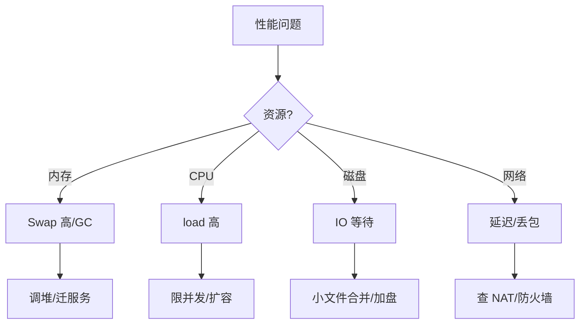

# 08 · 性能与容量

> 版本：v3.0 · 2026-11-09  
> 读者：架构、运维、性能工程师  
> 数据来源：qixuandata 集群实测  
> **v3.0 更新**：HA 后基线、70 表、3 链路 ≤25s、Flink 20s/302 checkpoint、磁盘 54.3%。

---

## 1. 资源基线（实测）

### 1.1 内存

| 指标 | 值 | 状态 |
|---|---|---|
| 宿主机总内存 | **48.8 GB**（2026-11-08 +8GB） | — |
| 当前 used | 34.7 GB | 正常 |
| available | **13.0 GB** | ✅ 充足 |
| Swap used | 8.0/8.1 GB (100%) | ⚠️ 满但 `si/so=0` |
| Load | 1min ≈ 13 / 5min 高 | ⚠️ 需观察 IO |

> **复核时间**：2026-11-08。宿主机扩容 +8GB 后 available 13GB；Swap 仍显示 100%，但 `vmstat` 的 `si/so=0`，说明是历史占用、无活跃换入换出。
>
> **容器上限已调整**：h0 20GB / h1 10GB / h2 9GB / h3 9GB，为容器级 HA 预留余量。

### 1.2 存储

| 指标 | 值 |
|---|---|
| HDFS 容量 | 1.2 TB |
| DFS 已用 | 79.1 GB (6.40%) |
| 非 DFS 已用 | 585.4 GB (47.34%) |
| 剩余 | 46.26% |
| 宿主机磁盘（`/usr/bigtop`） | 245.4 GB / 452 GB (**54.3%**) |
| 剩余可用 | 约 193 GB |

### 1.3 计算

| 组件 | 配置 |
|---|---|
| YARN NM | 6144 MB / 6 vcores × 3 |
| Flink | 2 TM × 2 slots × 2048m |
| Spark Thrift | 1024m 堆 |

---

## 2. JVM 堆调优案例

### 2.1 背景

调优前 h0 堆总量 ~23GB，Swap 100%，Ambari 检查超时误报。

### 2.2 调优前后

| 服务 | 旧 Xmx | 新 Xmx | 释放 |
|---|---|---|---|
| NameNode | 2048m | 1536m | -512m |
| ResourceManager | 2048m | 1536m | -512m |
| HBase Master | 1536m | 1024m | -512m |
| HiveServer2 | 2048m | 1024m | -1024m |
| HiveMetastore | 1024m | 512m | -512m |
| Ranger Admin | 1g | 768m | -256m |
| Ranger Usersync | 1g | 512m | -512m |
| Ranger KMS | 1g | 512m | -512m |
| Ambari Server | 2048m | 1024m | -1024m |
| Infra Solr | 2048m | 1024m | -1024m |
| JobHistory | 1024m | 512m | -512m |
| Spark History | 2048m | 1024m | -1024m |
| ZK | 1024m | 512m | -512m |

### 2.3 效果（2026-11-03 调优后，历史）

| 指标 | 前 | 后 |
|---|---|---|
| used | 33.5 GB | 28.5 GB |
| available | 5.0 GB | 10.0 GB |
| Swap | 100% | 43%（2026-11-03） |
| **2026-11-06 复核** | — | Swap 100%、avail 2.8GB（当时） |
| **2026-11-08 扩容** | — | **+8GB，avail 13GB；容器上限 10/9/9GB** |

### 2.4 关键经验


- 不要假设"小集群就该给大堆"
- Usersync/KMS/Timeline/History 512m 足够
- 必须通过 Ambari 配置中心（content 硬编码）

---

## 3. Flink 性能

### 3.1 资源配置

| 项 | 值 |
|---|---|
| TM | 2 × 2 slots |
| TM 内存 | 2048m（process size） |
| 并行度 | 2（default） |
| checkpoint | **20s**（2026-11-09 修正 `SqlJob.class` 硬编码 60s） |

### 3.2 实测

| 指标 | 值 |
|---|---|
| 端到端延迟 | **≤25s**（三链路同时探针） |
| checkpoint 耗时 | 秒级（20s 间隔） |
| checkpoint 成功率 | 302 完成 / 0 失败 |
| Kafka lag | 0 / 0 / 0 |
| Sink 数 | 3（AI / RAG / Answer） |

### 3.3 调优方向

| 场景 | 调整 |
|---|---|
| 延迟要求 <30s | checkpoint 20s（已实施，实测 ≤25s） |
| 吞吐更高 | 增 TM/slots |
| 状态大 | 增 TM 内存/本地盘 |

---

## 4. 查询性能

### 4.1 Spark ThriftServer

| 查询 | 实测 |
|---|---|
| `SHOW DATABASES` | <1s |
| `COUNT(*)` ODS（16 行） | ~1s |
| 全表扫描（小表） | 1-3s |

### 4.2 建议

- 优先 Spark ThriftServer（比 Hive 快）
- 必须加 `dt` 分区过滤
- 大表分页/聚合下推

---

## 5. Kafka 性能

| 指标 | 值 |
|---|---|
| 分区 | 3/topic |
| RF | 1 |
| 压缩 | lz4 |
| 消息 | 小 JSON |

**建议**：生产 RF≥2；分区数与 Flink 并行度匹配。

---

## 6. 容量模型

### 6.1 存储估算

```
日增数据量 = 消息数/天 × 平均大小 × (1+压缩比) × 副本数
示例：100万条/天 × 1KB × 0.3 × 3 ≈ 0.9 GB/天
年增 ≈ 330 GB（含 Iceberg 元数据）
```

### 6.2 计算估算

| 作业 | slots | 内存 |
|---|---|---|
| 实时（2 作业） | 2 | 4GB（TM） |
| Spark ETL | 按需 | YARN 容器 |
| Hive | 按需 | YARN |

### 6.3 扩容阈值

| 指标 | 阈值 | 动作 |
|---|---|---|
| HDFS 使用率 | >70% | 加盘/归档 |
| 内存 available | <4GB | 加内存/迁服务 |
| Swap | >80% | 调优/扩容 |
| Kafka lag | 持续 >1000 | 加并行度 |

---

## 7. 性能测试方法

### 7.1 HDFS

```bash
dd if=/dev/zero of=/tmp/1g bs=1M count=1024
time hdfs dfs -put /tmp/1g /test/1g
time hdfs dfs -cat /test/1g > /dev/null
```

### 7.2 Spark

```bash
time spark-submit --master yarn --class org.apache.spark.examples.SparkPi \
  /usr/bigtop/current/spark-client/examples/jars/spark-examples*.jar 10
```

### 7.3 Hive

```bash
time beeline -u 'jdbc:hive2://...:10000/default' -n hive -e 'select count(*) from t;'
```

### 7.4 HBase

```bash
hbase org.apache.hadoop.hbase.PerformanceEvaluation --rows=100000 randomWrite perf
hbase org.apache.hadoop.hbase.PerformanceEvaluation --rows=100000 randomRead perf
```

### 7.5 Kafka

```bash
kafka-producer-perf-test.sh --topic perf --num-records 100000 --record-size 1024 \
  --throughput -1 --producer-props bootstrap.servers=192.168.0.60:9092
```

---

## 8. 瓶颈分析



| 现象 | 可能原因 |
|---|---|
| 查询慢 | 未分区过滤、小文件多 |
| 作业重启 | OOM、checkpoint 超时 |
| Swap 高 | 堆过大、内存不足 |
| 磁盘满 | 日志、快照、小文件 |

---

## 9. 优化建议（按优先级）

| 优先级 | 建议 | 预期收益 |
|---|---|---|
| P0 | 内存已扩容（+8GB）；启动容器级最小 HA（h0–h3 容器即主机，见 [`../PRODUCTION_HA_UPGRADE_PLAN.md`](../PRODUCTION_HA_UPGRADE_PLAN.md)） | 消除容器单点 |
| P1 | Iceberg 每周治理 | 查询加速 |
| P1 | checkpoint 调优（按延迟要求） | 延迟降低 |
| P2 | Kafka RF≥2 | 可靠性 |
| P2 | 增加 TM/slots | 吞吐 |
| P3 | HDFS 归档 | 容量 |

---

## 10. 性能基线表（回归用）

| 指标 | 基线 | 告警阈值 |
|---|---|---|
| 实时延迟 | **≤30s（实测 ≤25s）** | >120s |
| checkpoint 成功 | >99% | <95% |
| Kafka lag | 0 | >1000 持续 5min |
| 查询（小表） | <3s | >10s |
| HDFS 写 | >100MB/s | <50MB/s |
| 内存 available | >8GB | <4GB |
| Swap | <60% | >80% |
