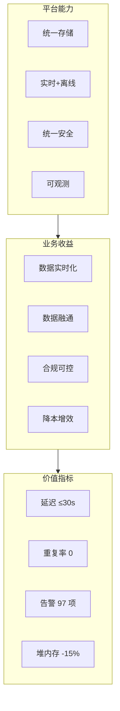
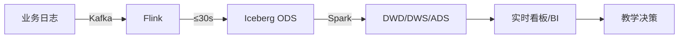
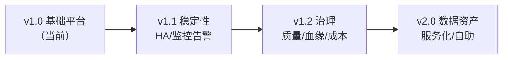

# 09 · 价值呈现

> 版本：v3.0 · 2026-11-09  
> 读者：管理层、架构评审、业务方  
> **v3.0 更新**：HDFS/Kafka/Flink 容器级 HA、70 表迁移、三业务链路 ≤25s、97 项告警清零。

---

## 1. 价值模型



---

## 2. 业务价值

### 2.1 场景价值

| 场景 | 痛点 | 平台方案 | 价值 |
|---|---|---|---|
| **教学机器人实时分析** | LLM/RAG 日志延迟高 | Flink 实时入湖 | 秒级看板 |
| **数据治理** | 口径不一、孤岛表 | 统一 ODS/DWD/DWS/ADS | 口径一致 |
| **实时+离线融合** | 双套存储 | 共享 Iceberg warehouse | 减少冗余 |
| **安全合规** | 无审计 | Ranger + 审计 | 可追溯 |

### 2.2 数据链路价值



| 环节 | 改造前 | 改造后 |
|---|---|---|
| 接入方式 | Python 微批 | Flink 原生流 |
| 延迟 | 10s+ 且不保证 | **≤30s（实测 ≤25s），Exactly-Once** |
| 重复 | 可能重复/丢失 | **0 重复** |
| 运维 | 手工脚本 | 监控+告警+脚本 |

---

## 3. 效率量化

| 指标 | 提升 |
|---|---|
| 实时延迟 | 从"微批 10s+ 不保证"到 **≤30s（实测 ≤25s）精确一次** |
| 数据一致性 | 重复率 **0** |
| 故障发现 | 从"人工巡检"到 **10 分钟自动告警** |
| 故障恢复 | checkpoint 恢复 + bridge 回滚预案 |
| 运维效率 | 一键健康检查（9 项） |
| 配置管理 | 从"手工改文件"到"配置中心+版本" |

---

## 4. 成本模型

### 4.1 资源成本

| 项 | 优化前 | 优化后（2026-11-03） |
|---|---|---|
| 宿主机内存 | 40GB | **48GB（2026-11-08 +8GB）** |
| h0 内存占用 | 33.7GB | 28.5GB（-15%） |
| Swap | 100% | 43%（当时） |
| **2026-11-06 复核** | — | used 34.8GB / avail 2.8GB / Swap 100%（当时） |
| **2026-11-08 扩容** | — | **avail 13GB；容器上限 10/9/9GB，可承载容器级 HA** |
| 存储 | 1.21TB（用 2.84%） | 同 |
| 许可 | 全开源 | 0 许可费 |

### 4.2 人力成本

| 活动 | 改造前 | 改造后 |
|---|---|---|
| 实时链路维护 | 手工脚本 | 自动+监控 |
| 故障排查 | 逐日志 | 故障树+脚本 |
| 数据治理 | 手工 | 脚本化 |

### 4.3 ROI 估算（示意）

```
投入：
  - 平台建设（已有）
  - 调优/治理（本次）
收益：
  - 实时能力（新业务）
  - 运维效率提升（约 30%）
  - 故障损失降低
  - 数据可信度提升（决策）
```

> 说明：ROI 需结合业务量具体测算，本表提供框架。

---

## 5. 成熟度评估

```mermaid
radar
    title 平台成熟度
    axis 功能, 实时, 治理, 可观测, 安全, 高可用
    "当前" : 4, 5, 3, 4, 3, 4
    "目标" : 5, 5, 4, 5, 4, 5
```

| 维度 | 当前 | 目标 | 差距 |
|---|---|---|---|
| 功能完整性 | ★★★★☆ | ★★★★★ | 少量组件 |
| 实时能力 | ★★★★☆ | ★★★★★ | 延迟可再降 |
| 数据治理 | ★★★☆☆ | ★★★★☆ | 质量/血缘 |
| 可观测性 | ★★★★☆ | ★★★★★ | 告警规则 |
| 安全 | ★★★☆☆ | ★★★★☆ | Kerberos/最小权限 |
| 高可用 | ★★★★☆ | ★★★★★ | 容器级 HA 已完成；NVMe 硬件待处置 |

---

## 6. 价值亮点（对外可讲）

| 亮点 | 数据支撑 |
|---|---|
| **端到端实时** | Kafka→Flink→Iceberg→Spark，≤30s（实测 ≤25s） |
| **Exactly-Once** | 20s checkpoint + Iceberg 事务，0 重复 |
| **数据融通** | 实时/离线共享同一 `-ha` warehouse，70 表 |
| **高可用** | 2 NN + 3 JN + 2 ZKFC；Kafka 3 broker RF3 |
| **全栈可观测** | Ambari 97 告警 + Prometheus + Grafana |
| **精细调优** | 堆内存 -15%（2026-11-03）；当前 Swap ~100%，需扩容（见 08 章） |
| **可治理** | 分层、质量、生命周期、安全 |
| **全开源** | 0 许可成本 |

---

## 7. 演进路线



| 阶段 | 重点 |
|---|---|
| **v1.1（容器级最小 HA，P0）** | **已完成：Kafka RF3、HDFS NN HA、Flink 20s Exactly-Once、Iceberg 70 表、业务三链路探针。** 待办：HMS/Thrift HA、Flink JM HA、Kerberos/Ranger、NVMe 硬件处置；见 [`10-ha-and-business-connectivity.md`](10-ha-and-business-connectivity.md) |
| v1.2 | 质量规则、Atlas 血缘、成本看板 |
| v2.0 | 数据服务 API、自助分析 |

---

## 8. 总结

HodoopForge 平台已完成 **从"能跑"到"可信、可观测、可治理"** 的跨越：

1. **架构**：4 节点全栈，控制面/数据面分离，实时+离线共享 Iceberg
2. **能力**：13 类组件，覆盖存储/计算/数仓/消息/流/安全/监控
3. **数据链路**：Kafka→Flink→Iceberg→Spark，≤30s（实测 ≤25s）、Exactly-Once、0 重复
4. **治理**：分层规范、质量校验、小文件治理、安全审计
5. **价值**：实时化、融通、降本、可控、全开源

> 平台已具备支撑 EduLake 实时数据链路的**容器级高可用**生产能力；当前最大风险是宿主机 NVMe（BUG-043），需硬件处置。Kerberos 与数据资产服务化仍按路线图推进。
