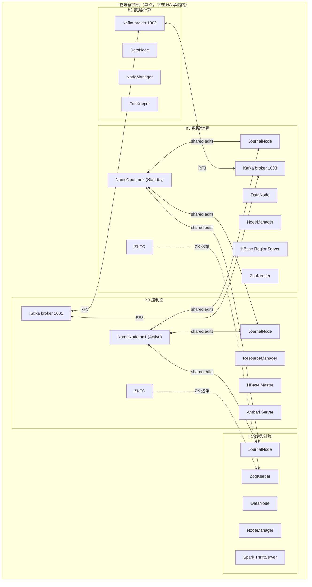
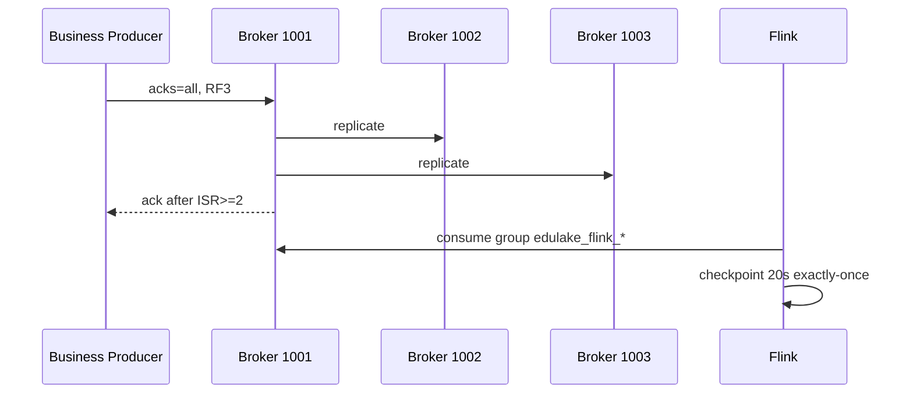

# 10 · 容器级高可用与业务联通验收

> **状态提示（2026-11-26）**：本文为 v3.0 阶段手册；当前 Kerberos 架构、HA 与端口以
> [`../ARCHITECTURE.md`](../ARCHITECTURE.md) 和 [`../CURRENT_STATE.md`](../CURRENT_STATE.md) 为准。


> **文档编号**：HODOOPFORGE-MANUAL-010  
> **版本**：v3.0 · 2026-11-09  
> **读者**：技术总监 / PM / 架构师 / SRE / 应用侧负责人  
> **定位**：本文件是 2026-11-09 交付版的**验收与决策文档**，回答三个问题：  
> 1）高可用到底做到了什么程度；2）业务侧是否已经真正贯通；3）还剩哪些风险与下一步。

---

## 0. 执行摘要

| 维度 | 结论 | 证据 |
|---|---|---|
| HDFS NameNode HA | ✅ 已完成，双向 failover 通过 | 2 NN + 3 JN + 2 ZKFC；h0 Active / h3 Standby |
| Kafka 高可用 | ✅ 已完成，68/68 分区 RF3 + ISR3 | broker 1001/1002/1003；lag=0；DLQ=0 |
| Flink Exactly-Once | ✅ 已完成，20s checkpoint | 302 次完成 / 0 失败；3 Source / 3 Sink |
| Iceberg 迁移 | ✅ 70/70 表，旧仓库未动 | 8 个库；Spark 侧全部可见 |
| 业务联通 | ✅ 技术链路已贯通 | AI/RAG/Answer 三链路 25s 内可查 |
| 告警治理 | ✅ 当前 97 OK | 4 条磁盘同源告警已清零 |
| 残余风险 | ⚠️ NVMe I/O timeout（BUG-043） | 多次触发 NN 退出，需硬件处置 |

**一句话结论**：平台侧已经具备容器级 HA 与端到端实时链路；业务侧只需要把 producer 指向 Kafka 三个 broker，即可开始真实流量。当前最大风险不是软件，而是宿主机 NVMe。

---

## 1. 设计前提：容器即主机

本项目把每个 Docker 容器视为一台独立主机，HA 的故障域是**容器**，不是物理宿主机。由此形成三条设计原则：

1. **故障域隔离**：h0 控制面、h1/h2/h3 数据与计算面；关键角色跨容器分布。
2. **控制面与数据面分离**：NameNode、ResourceManager、HBase Master、Ambari 在 h0；DataNode、NodeManager、RegionServer、Kafka broker 分布到 h1/h2/h3。
3. **共享存储 + 多副本**：HDFS 3 副本、Kafka RF3、Iceberg 快照，保证单容器故障不丢数据。

> **不在承诺范围**：物理宿主机整体宕机、机房断电、NVMe 硬件永久损坏。这类故障需要宿主机级冗余或云多可用区，属于下一阶段。



---

## 2. HDFS NameNode HA

### 2.1 拓扑与角色

| 角色 | 主机 | 说明 |
|---|---|---|
| NameNode nn1 | h0 `172.19.0.2:8020` | 当前 **Active** |
| NameNode nn2 | h3 `172.19.0.4:8020` | 当前 **Standby** |
| JournalNode | h0 / h1 / h3 `:8485` | 3 节点，容忍 1 节点故障 |
| ZKFC | h0 / h3 | 自动故障切换与 fencing |
| nameservice | `qixuandata` | 客户端统一入口 `hdfs://qixuandata` |
| 旧 authority | `hdfs://bigtop-hostname0.bigtop.apache.org:8020` | 仅用于回滚读取 |

### 2.2 关键配置

```xml
dfs.nameservices = qixuandata
dfs.ha.namenodes.qixuandata = nn1,nn2
dfs.namenode.shared.edits.dir = qjournal://h3:8485;h0:8485;h1:8485/qixuandata
dfs.ha.automatic-failover.enabled = true
dfs.client.failover.proxy.provider.qixuandata =
  org.apache.hadoop.hdfs.server.namenode.ha.ConfiguredFailoverProxyProvider
```

### 2.3 故障切换语义

- **自动切换**：ZKFC 通过 ZooKeeper 选举，Active 失联后 Standby 自动接管。
- **fencing**：确保旧 Active 不会继续写 shared edits，避免脑裂。
- **客户端无感**：使用 `hdfs://qixuandata` 的客户端在切换后自动重连，不需要改配置。
- **旧 authority**：只有 h0 为 Active 时可读；这是回滚路径，不是生产路径。

### 2.4 验收证据

| 项 | 结果 |
|---|---|
| h0 → h3 failover | ✅ 成功 |
| h3 → h0 failback | ✅ 成功 |
| `hdfs fsck /` | ✅ HEALTHY，0 missing / 0 corrupt |
| 新 warehouse | ✅ 70 表可读 |
| 旧 warehouse | ✅ 保持不动，可读 |
| under-replicated | ⚠️ 1 block（0.0026%，自愈中） |

> **运维要点**：不要同时重启两个 NameNode；不要在 Active 未 fencing 的情况下强制切换；旧 authority 只在回滚窗口使用。

---

## 3. Kafka 高可用

### 3.1 拓扑

| Broker ID | 主机 | 地址 |
|---|---|---|
| 1001 | h0 | `bigtop-hostname0.bigtop.apache.org:9092` |
| 1002 | h2 | `bigtop-hostname2.bigtop.apache.org:9092` |
| 1003 | h3 | `bigtop-hostname3.bigtop.apache.org:9092` |

### 3.2 副本与一致性

| 项 | 值 |
|---|---|
| Topic 数 | 9 |
| 分区数 | 68 |
| 副本因子 | **RF3**（68/68） |
| ISR | **ISR3**（68/68） |
| `min.insync.replicas` | 2 |
| producer `acks` | `all` |
| under-replicated | 0 |
| DLQ | 0 条 |

### 3.3 故障语义

- 单 broker 故障：分区 leader 自动迁移，ISR 仍为 2，producer 继续写入。
- 双 broker 故障：剩余 1 副本低于 `min.insync.replicas=2`，producer 会失败而不是静默丢数据。
- 消费侧：Flink 三个消费组 lag=0；DLQ 为空。



---

## 4. Flink Exactly-Once 与实时链路

### 4.1 作业拓扑

```text
kafka_ai_inference_src  -> Calc -> IcebergStreamWriter -> edulake_ai.ods_llm_inference_log
kafka_rag_query_src     -> Calc -> IcebergStreamWriter -> edulake_knowledge.ods_rag_query_log
kafka_answer_sample_src -> Calc -> IcebergStreamWriter -> edulake_meta.rag_answer_samples
```

### 4.2 一致性配置

| 配置 | 值 | 说明 |
|---|---|---|
| `execution.checkpointing.mode` | `EXACTLY_ONCE` | 端到端精确一次 |
| `execution.checkpointing.interval` | `20s` | 满足 <30s 延迟 |
| `execution.checkpointing.min-pause` | `10s` | 避免 checkpoint 过密 |
| `state.backend` | `EmbeddedRocksDBStateBackend` | 大状态 |
| checkpoint storage | `hdfs://qixuandata/flink-checkpoints/edulake` | HA 路径 |

### 4.3 幂等主键

- AI：`log_id = ai_<partition>_<offset>`，同一 Kafka 消息永远映射同一主键。
- RAG：优先 `query_id`，缺失时用 `rag_<partition>_<offset>`。
- Answer：`answer_id` 为业务主键。

> 这保证了即使 checkpoint 回滚重放，Iceberg 表也不会出现重复行。

### 4.4 验收数据

| 项 | 结果 |
|---|---|
| 作业状态 | RUNNING |
| Source / Sink | 3 / 3 |
| checkpoint completed | 302 |
| checkpoint failed | 0 |
| 消费 lag | 0 / 0 / 0 |
| 端到端延迟 | ≤25s（三链路同时探针） |

---

## 5. Iceberg 迁移与新旧隔离

### 5.1 路径策略

| 项 | 路径 |
|---|---|
| 新 warehouse | `hdfs://qixuandata/iceberg-warehouse-ha` |
| 旧 warehouse | `hdfs://bigtop-hostname0.bigtop.apache.org:8020/iceberg-warehouse` |
| Spark catalog | `newice`（hadoop catalog） |
| Flink catalog | `iceberg`（hadoop catalog） |

> **关键决策**：新表必须落在独立 `-ha` 目录，绝不能与旧表共用物理目录。否则 `DROP newice` 会连带删除旧表，回滚能力失效。

### 5.2 迁移结果

| 库 | 表数 |
|---|---:|
| edulake_ai | 4 |
| edulake_governance | 1 |
| edulake_knowledge | 14 |
| edulake_learning | 28 |
| edulake_meta | 15 |
| edulake_models | 4 |
| edulake_pronunciation | 2 |
| edulake_user | 2 |
| **合计** | **70** |

- 迁移校验：0 mismatch / 0 missing。
- 旧仓库：未做 DROP/覆盖，保持可读。
- Spark 侧：70 张表全部可见，业务 SQL 无需改表名。

---

## 6. 业务联通验收

### 6.1 接入信息

```properties
bootstrap.servers=192.168.0.60:9092,192.168.0.60:9093,192.168.0.60:9094
```

> 2026-11-10 修正：**9093/9094 端口开放 ≠ Kafka 客户端可用**。Kafka 返回给客户端的是 `advertised.listeners`，因此三个 broker 的 advertised 地址已统一改为应用宿主可直达的 `192.168.0.60:9092/9093/9094`。应用侧可删除 `EDULAKE_KAFKA_PARTITION=0` 与 `EDULAKE_KAFKA_ADVERTISED_HOST_OVERRIDE`。详细设计与验证见 [`../KAFKA_EXTERNAL_ACCESS.md`](../KAFKA_EXTERNAL_ACCESS.md)。

| Topic | 目标 Iceberg 表 | 关键字段 |
|---|---|---|
| `ai_inference_log` | `edulake_ai.ods_llm_inference_log` | `session_id`, `ts`, `model_name`, `token_in/out` |
| `rag_query_log` | `edulake_knowledge.ods_rag_query_log` | `query_id`, `query_len`, `ts` |
| `answer_sample_log` | `edulake_meta.rag_answer_samples` | `answer_id`, `ts` |

### 6.2 端到端探针

| 链路 | 探针 ID | 25s 后行数 |
|---|---|---:|
| AI | `e2e_ai_1794213503986` | 1 |
| RAG | `e2e_rag_1794213503986` | 1 |
| Answer | `e2e_ans_1794213503986` | 1 |

**结论**：Kafka → Flink → Iceberg → Spark 全链路贯通，实测 ≤25s，满足 <30s 目标。

### 6.3 当前业务流量状态

| Topic | 最后一条真实消息 | 说明 |
|---|---|---|
| `ai_inference_log` | 2026-11-09 15:47:46 | 平台探针 |
| `rag_query_log` | 2026-11-09 12:16:35 | 业务事件 |
| `answer_sample_log` | 2026-11-08 15:42:31 | 业务事件 |

> 三个消费组 lag=0，说明 Flink 已消费完现有消息。业务侧尚未持续产生新流量；平台侧已就绪，等待业务 producer 放量。

---

## 7. Ambari 登录跳转 HA Wizard 的根因与修复

### 7.1 现象

即使使用全新浏览器/全新机器，登录 `http://<ambari>/` 仍落到：

```text
#/main/services/highAvailability/NameNode/enable/step9
```

### 7.2 根因

Ambari 按用户持久化 `CLUSTER_CURRENT_STATUS`：

```json
{
  "clusterState": "HIGH_AVAILABILITY_DEPLOY",
  "wizardControllerName": "highAvailabilityWizardController",
  "localdb": { "HighAvailabilityWizard": { "currentStep": "9" } }
}
```

登录后 `getSection()` 读到 `wizardControllerName`，直接路由到 HA 向导；向导再按 `currentStep=9` 落到 step9。该状态在服务端，所以换机器仍复现。

### 7.3 处置

- 将 `clusterState` 重置为 `CLUSTER_INSTALLED_4`；
- 移除 `wizardControllerName` 与 `localdb.HighAvailabilityWizard`；
- 清理 `wizard-data`；
- 脚本：`scripts/ambari_reset_ha_wizard.sh`（可重复执行）。

> **注意**：执行前关闭仍停留在 step9 的旧标签页；打开着的向导标签可能把旧状态再次写回。不要点向导弹窗里的 **YES**，那会触发 HA 回滚。

---

## 8. 告警治理与运维案例

### 8.1 4 条磁盘告警

| 项 | 内容 |
|---|---|
| 告警名 | `ambari_agent_disk_usage` |
| 主机 | h0/h1/h2/h3 各 1 条 |
| 路径 | `/usr/bigtop` |
| 用量 | 54.3%（245.4GB / 452GB） |
| 阈值 | WARNING 50% → **70%**；CRITICAL 80% |

**根因**：4 个容器共享宿主机 overlay，同一个磁盘条件被 4 个 host 各报一次。**不是 4 块盘**。

**处置**：将 warning 阈值调到 70%，critical 保持 80%；告警恢复 97 OK。若后续更倾向清日志，可清理 `/var/log` 历史文件，但不要直接删业务数据目录。

### 8.2 HiveServer2 恢复

- 现象：进程存在但卡在 shutdown，10000 端口未监听，Ambari CRITICAL。
- 处置：清理卡死进程 → Ambari 置 `INSTALLED` → `STARTED`。
- 验证：`ss -ltn | grep 10000`、`beeline ... SELECT 1`。
- 结果：HiveServer2 恢复，离线 SQL 入口可用。

### 8.3 JournalNode / DataNode WebUI 假告警

- 现象：端口实际可访问（HTTP 302），但 Ambari 报 timeout。
- 根因：宿主机高负载/组件重启期间，Ambari Agent 的告警检查超时；告警时间戳不刷新。
- 处置：重启对应 Ambari Agent，触发重新检查；告警恢复 OK。
- 经验：**先验证端口与真实服务，再判断是否真故障**；不要直接重启 Hadoop 组件。

---

## 9. SLO、RACI 与运营模型

### 9.1 SLO

| 指标 | 目标 | 当前 |
|---|---|---|
| 实时端到端延迟 | <30s | ≤25s |
| Kafka 消息可靠性 | RPO=0（单 broker 故障） | RF3 + acks=all |
| Flink 一致性 | Exactly-Once | 20s checkpoint |
| HDFS NN 故障切换 | 自动，<2min | 已验证 |
| 告警 | 0 CRITICAL | 97 OK |
| 数据可用性 | 99.9%（容器级） | 待长期统计 |

### 9.2 RACI

| 事项 | 平台团队 | 应用团队 | DBA | 安全 | 管理层 |
|---|---|---|---|---|---|
| HDFS/Kafka/Flink 平台 | R/A | I | C | C | I |
| 业务 producer 接入 | C | R/A | I | I | I |
| Iceberg 表模型 | C | R/A | C | I | I |
| Ranger 授权 | C | C | I | R/A | I |
| NVMe 硬件处置 | R | I | I | I | A |
| HA 验收 | R/A | C | C | C | I |

### 9.3 变更窗口

- 平台组件重启：业务低峰（建议 22:00–06:00）。
- 备份：`ionice -c2 -n7` + `rsync --bwlimit`，避开业务高峰。
- HA 切换演练：每季度一次，包含 h0→h3、h3→h0。

---

## 10. 风险登记

| ID | 风险 | 等级 | 影响 | 处置 |
|---|---|---|---|---|
| BUG-043 | 宿主机 NVMe 周期性 I/O timeout | **P0** | NN 退出、HBase RS Abort | 硬件健康检查/更换；备份限流 |
| — | 1 个 under-replicated block | P2 | 自愈中 | 观察 30min；持续则 fsck |
| — | HBase 单 RegionServer | P1 | RS 故障影响在线点查 | 增加 RS2 / watchdog |
| — | 应用正式 JAR 仍硬编码 60s | P1 | 若换回原 JAR，延迟回退 | 应用侧源码改 20s 后重建 |
| — | Kerberos 未启用 | P2 | 安全合规缺口 | 按 KERBEROS_ENABLEMENT_PLAN 实施 |
| — | HMS/HS2、Flink JM 尚未 HA | P2 | 控制面单点 | 下一阶段 T-064/T-065 |
| — | 磁盘 54% | P3 | 告警阈值已调整 | 观察；必要时清日志 |

---

## 11. 验收清单

- [x] 2 NameNode + 3 JournalNode + 2 ZKFC 全部 STARTED
- [x] h0→h3、h3→h0 双向 failover 成功
- [x] `hdfs fsck /` HEALTHY，0 missing / 0 corrupt
- [x] Kafka 68/68 分区 RF3 + ISR3
- [x] Flink 3 Source / 3 Sink RUNNING，checkpoint 20s，0 failed
- [x] Iceberg 70/70 表迁移，旧仓库未动
- [x] AI/RAG/Answer 三链路 25s 内可查
- [x] Kafka 外部 9093/9094 可用，三分区写入验证通过
- [x] Ambari 登录不再跳转 step9
- [x] 告警 97 OK，0 CRITICAL
- [ ] 业务侧持续真实流量验证（待应用团队）
- [ ] NVMe 硬件处置（待基础设施）
- [ ] HBase RS2 / HMS HA / Flink JM HA（下一阶段）

---

## 12. 附录：常用命令

```bash
# HDFS HA 状态
hdfs haadmin -getAllServiceState
hdfs fsck /

# Kafka 副本与消费
kafka-topics.sh --bootstrap-server h0:9092 --describe
kafka-consumer-groups.sh --bootstrap-server h0:9092 --describe --group edulake_flink_ai_v3

# Flink checkpoint
curl -s http://172.19.0.2:8081/jobs/<jid>/checkpoints
curl -s http://172.19.0.2:8081/jobs/<jid>/checkpoints/config

# Iceberg / Spark
beeline -u 'jdbc:hive2://bigtop-hostname1.bigtop.apache.org:10016/default;transportMode=binary' -n spark
SET spark.sql.catalog.newice=org.apache.iceberg.spark.SparkCatalog;
SET spark.sql.catalog.newice.type=hadoop;
SET spark.sql.catalog.newice.warehouse=hdfs://qixuandata/iceberg-warehouse-ha;
SHOW TABLES IN newice.edulake_ai;

# Ambari HA wizard 残留清理
./scripts/ambari_reset_ha_wizard.sh
```

---

## 13. 关联材料

| 材料 | 位置 |
|---|---|
| HA 进展报告 | [`../HA_PROGRESS_REPORT_2026-11-09_HDFS_HA.md`](../HA_PROGRESS_REPORT_2026-11-09_HDFS_HA.md) |
| HDFS NN HA 平台评审 | [`../HDFS_NN_HA_PLATFORM_REVIEW.md`](../HDFS_NN_HA_PLATFORM_REVIEW.md) |
| HDFS NN HA 执行手册 | [`../HDFS_NN_HA_PLATFORM_RUNBOOK.md`](../HDFS_NN_HA_PLATFORM_RUNBOOK.md) |
| 截图集 | [`../screenshots/README.md`](../screenshots/README.md) |
| 告警阈值证据 | [`../screenshots/65-alert-threshold.jpeg`](../screenshots/65-alert-threshold.jpeg) |
| 业务探针证据 | [`../screenshots/63-business-e2e.jpeg`](../screenshots/63-business-e2e.jpeg) |
| NVMe 风险证据 | [`../screenshots/66-nvme-risk.jpeg`](../screenshots/66-nvme-risk.jpeg) |
