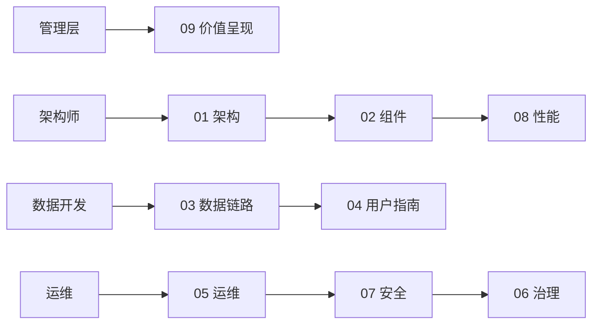

# HodoopForge 大数据平台 · 深度文档集

> **文档编号**：HODOOPFORGE-MANUAL-003  
> **版本**：v3.1（2026-11-26 Kerberos 现状）  
> **日期**：2026-11-26  
> **说明**：本目录为平台**高价值深度文档集**，含架构图（Mermaid）、时序图、实测数据、配置细节、故障树与价值模型。  
> 概要版入口见 `../PLATFORM_TECH_USER_MANUAL.md`。
>
> **v3.1（2026-11-26）**：HDFS/HBase/Hive/YARN/Flink/Kafka/Spark 已启用 Kerberos；Ambari `security_type=KERBEROS`；`kerberos_guard` 锁 agent。**当前架构以 [`../ARCHITECTURE.md`](../ARCHITECTURE.md) 为准。**
>
> **v3.0（2026-11-09）**：新增《容器级高可用与业务联通验收》；同步 HDFS NN HA、Kafka RF3、Flink 20s Exactly-Once、Iceberg 70 表迁移、Ambari 登录跳转修复、磁盘告警治理、HiveServer2 恢复、NVMe 风险与三业务链路探针。

---

## 文档地图

| 编号 | 文档 | 内容 | 目标读者 |
|---|---|---|---|
| 01 | [架构设计](01-architecture.md) | 逻辑/部署/网络/数据流架构（Mermaid） | 架构师、运维 |
| 02 | [组件详解](02-components.md) | 13 类组件原理、配置、限制、最佳实践 | 运维、开发 |
| 03 | [数据链路](03-data-pipeline.md) | 实时/离线链路、Exactly-Once、时序图 | 数据开发 |
| 04 | [用户指南](04-user-guide.md) | 场景化接入、SQL/命令、规范 | 业务/开发 |
| 05 | [运维手册](05-operations.md) | 巡检、故障树、案例复盘、变更 | 运维 |
| 06 | [数据治理](06-governance.md) | 分层、血缘、质量、SLA、生命周期 | 数据治理 |
| 07 | [安全体系](07-security.md) | Ranger 架构、策略模型、KMS、审计 | 安全/运维 |
| 08 | [性能与容量](08-performance.md) | 实测基线、调优案例、容量模型 | 架构/运维 |
| 09 | [价值呈现](09-value.md) | 量化模型、ROI、成熟度 | 管理层 |
| — | [当前架构总览](../ARCHITECTURE.md) | 4 容器、Kerberos、HA、端口、防呆、回滚 | 全员 |
| 10 | [HA 与业务联通验收](10-ha-and-business-connectivity.md) | HDFS/Kafka/Flink/Iceberg HA、业务探针、SLO/RACI、风险登记 | 管理层、架构师、PM、SRE、应用侧 |

## 阅读路径

## 文档原则

1. **图优先**：架构/流程/状态用 Mermaid 表达，避免纯文字堆砌
2. **实测为准**：所有数字来自当前集群（2026-11-03）
3. **可执行**：命令、配置、SQL 可直接复制使用
4. **有深度**：不仅"是什么"，还包括"为什么""限制""调优""故障"
5. **可演进**：每章标注版本与变更入口

---

## 配套材料

| 材料 | 位置 | 说明 |
|---|---|---|
| **操作界面截图集** | [`../screenshots/README.md`](../screenshots/README.md) | 67 张实景截图（Ambari + 各组件 UI + 数据治理 + 2026-11-09 HA/业务联通证据） |
| 流水线视频（无声） | [`../screenshots/pipeline-demo.mp4`](../screenshots/pipeline-demo.mp4) | 1280×1024，36 场景，约 1:48 |
| 流水线视频（中文解说） | [`../screenshots/pipeline-demo-narrated.mp4`](../screenshots/pipeline-demo-narrated.mp4) | 6:26，36 段中文旁白 + 软字幕（Edge TTS 晓晓） |
| **HA 与业务联通验收** | [`10-ha-and-business-connectivity.md`](10-ha-and-business-connectivity.md) | 容器级 HA、业务探针、SLO/RACI、风险登记 |
| **视频号发布物料** | [`../VIDEO_CHANNEL_PUBLISH_KIT_2026-11-09.md`](../VIDEO_CHANNEL_PUBLISH_KIT_2026-11-09.md) | 标题、描述、话题、封面、置顶评论 |
| **Kafka 外部访问** | [`../KAFKA_EXTERNAL_ACCESS.md`](../KAFKA_EXTERNAL_ACCESS.md) | 9093/9094 端口转发、三分区写入、应用侧接入 |
| 平台说明书（概要） | [`../PLATFORM_TECH_USER_MANUAL.md`](../PLATFORM_TECH_USER_MANUAL.md) | 单文件版 |
| Flink 运维手册 | [`../FLINK_OPS_RUNBOOK.md`](../FLINK_OPS_RUNBOOK.md) | 实时链路 |
| Kerberos 启用方案 | [`../KERBEROS_ENABLEMENT_PLAN.md`](../KERBEROS_ENABLEMENT_PLAN.md) | 安全合规 |
| **生产最小 HA 升级方案** | [`../PRODUCTION_HA_UPGRADE_PLAN.md`](../PRODUCTION_HA_UPGRADE_PLAN.md) | Kafka RF3 / HDFS NN HA / HMS·Thrift HA / Flink JM HA / 安全 / 监控 |
| **HA 进展报告（Kafka RF3）** | [`../HA_PROGRESS_REPORT_2026-11-08.md`](../HA_PROGRESS_REPORT_2026-11-08.md) | 已完成项与故障注入证据 |
| **HDFS NN HA 完成报告** | [`../HA_PROGRESS_REPORT_2026-11-09_HDFS_HA.md`](../HA_PROGRESS_REPORT_2026-11-09_HDFS_HA.md) | 2 NN + 3 JN + ZKFC，failover 证据 |
| **HDFS NN HA 平台评审** | [`../HDFS_NN_HA_PLATFORM_REVIEW.md`](../HDFS_NN_HA_PLATFORM_REVIEW.md) | 交接单评审、预检、窗口建议 |
| **HDFS NN HA 执行手册** | [`../HDFS_NN_HA_PLATFORM_RUNBOOK.md`](../HDFS_NN_HA_PLATFORM_RUNBOOK.md) | 平台侧 2 小时窗口执行步骤 |
